# HomeStayDorm: xác nhận bàn giao phòng và đối soát tiền cọc trên Avalanche

HomeStayDorm là hệ thống quản lý thuê phòng ký túc/homestay (đăng ký, xem phòng, cọc, hợp đồng, hóa đơn, trả phòng). Bài thi Team1 Vietnam UniHack 2026 thêm hai lần **khách thuê tự xác nhận trên Avalanche**: xác nhận biên bản bàn giao lúc nhận phòng, và xác nhận kết quả đối soát tiền cọc lúc trả phòng. Chuỗi không giữ tiền. Nó giữ bằng chứng rằng khách đã đồng ý đúng phiên bản nào, để khách tự kiểm tra lại bằng file mình giữ mà không phải xin bên cho thuê.

> **English summary.** A dorm/homestay rental system (React + Express + SQL Server). On Avalanche C-Chain, the tenant signs (EIP-712, embedded wallet, gas paid by a relayer) the exact version of the move-in inspection report and of the deposit settlement. Disputes create a new version and keep the old one. Anyone holding the evidence file can verify it against the chain without the operator's API. No funds are held on-chain.

## Trạng thái bản nộp

Cập nhật 11/11/2026. Ô nào còn "chưa có" sẽ được điền sau khi chạy thật; README không ghi kết quả chưa có bằng chứng.

| Phần | Trạng thái |
|---|---|
| Web2: năm vai trò (khách, Sale, quản lý, kế toán, Admin), nhiều chi nhánh | Chạy trên máy local với SQL Server |
| Contract `DormSettlement` (EIP-712), relayer trả gas, ví nhúng Privy, trang kiểm chứng | Chạy và có test trên chain local (Hardhat 31337) |
| Triển khai Fuji, verify source | **Đã có** (11/11/2026): contract và mã nguồn verify khớp chính xác, xem mục [3.4](#34-triển-khai-trên-fuji) |
| Giao dịch nghiệp vụ thật trên Fuji (bàn giao, đối soát) | **Chưa có**, điền sau việc A3 |
| Cổng thanh toán ví điện tử | **Mô phỏng**, xem [mục 6](#6-phần-mô-phỏng) |
| Dữ liệu | Dữ liệu giả, không có người dùng thật |

## 1. Bài toán và người dùng

Khi trả phòng, chủ nhà và người thuê hay tranh cãi tiền cọc. Một vết rách có từ trước có thể bị tính là hư hỏng mới. Biên bản giấy lúc nhận phòng thường qua nhiều tay và dễ thất lạc. Bảng trừ cọc chỉ nằm trong máy của bên cho thuê, có thể sửa mà khách không biết.

Người dùng:

- **Người thuê** (sinh viên, người đi làm thuê giường/phòng): muốn biết chính xác mình đã đồng ý với nội dung nào và giữ được bằng chứng.
- **Bên cho thuê** (quản lý chi nhánh, kế toán): muốn hồ sơ bàn giao và đối soát rõ ràng, giảm thời gian tranh cãi.

HomeStayDorm giữ toàn bộ nghiệp vụ trên Web2. Chỉ hai thời điểm cần sự đồng ý của cả hai bên mới được ghi lên chuỗi. Khách xác nhận ngay trong tab **Hợp đồng** của mình: không cài ví, không cần AVAX, không thấy địa chỉ ví hay mã giao dịch.

## 2. Luồng

```mermaid
flowchart LR
  A[Đăng ký, xem phòng] --> B[Giữ chỗ] --> C[Trả cọc] --> D[Khai người ở] --> E[Hợp đồng + kỳ đầu]
  E --> F[Bàn giao phòng]
  F --> M1{{Mốc 1 trên Avalanche<br/>Khách xác nhận biên bản}}
  M1 --> G[Đang ở: hóa đơn tháng] --> H[Trả phòng, kiểm tra]
  H --> I[Kế toán lập đối soát v1]
  I -->|Khách phản đối, ghi lý do| J[Kế toán lập v2, giữ v1]
  J --> M2{{Mốc 2 trên Avalanche<br/>Khách đồng ý đối soát}}
  I --> M2
  M2 --> K[Hoàn/thu thêm tiền trên Web2, đóng hồ sơ]
  classDef web2 fill:#f1f4f0,stroke:#c9cfc7,color:#5e655c
  classDef chain fill:#4a6549,stroke:#3d553c,color:#ffffff,font-weight:bold
  class A,B,C,D,E,F,G,H,I,J,K web2
  class M1,M2 chain
```



- Khách yêu cầu sửa biên bản thì quản lý phát hành bản mới ở Web2. Chỉ bản khách bấm xác nhận mới lên chuỗi.
- Biên bản bàn giao (gói v2) gồm điều khoản chính của hợp đồng, phiên bản chính sách hoàn cọc khách đã thấy lúc cọc, mã băm ảnh tình trạng phòng và mã băm bản chụp hợp đồng giấy đã ký.
- Không ai xác nhận thay khách. Nếu khách im lặng quá hạn, quản lý có thao tác Web2 "Thanh lý không có xác nhận của khách" (bắt buộc lý do và bằng chứng đã liên hệ). Chuỗi vẫn ghi đúng là khách chưa đồng ý.

Chi tiết từng giai đoạn: [spec/luong-tong-hop.md](spec/luong-tong-hop.md).

## 3. Phần trên Avalanche

### 3.1 Contract

[`blockchain/contracts/DormSettlement.sol`](blockchain/contracts/DormSettlement.sol), Solidity 0.8.38, OpenZeppelin `EIP712` + `SignatureChecker`.

| Hàm | Ai gọi | Việc |
|---|---|---|
| `proposeHandover` | Khóa vận hành "quản lý" (máy chủ) | Ghi commitment của biên bản bàn giao, ví khách, số cọc, mã băm chính sách |
| `proposeSettlement` | Khóa vận hành "kế toán" (máy chủ) | Ghi phiên bản đối soát mới; contract tự tính số hoàn hoặc số thu thêm |
| `confirm` | Bất kỳ ai trả gas (relayer) | Chỉ thành công khi có chữ ký EIP-712 hợp lệ của **đúng khách**: xác nhận biên bản (1), đồng ý đối soát (2), phản đối kèm mã băm lý do (3) |

Trạng thái: `HandoverProposed → Active → SettlementProposed → (Disputed → SettlementProposed) → Accepted`.

Chữ ký ràng buộc loại hành động, mã hồ sơ, phiên bản, commitment, nonce, hạn dùng và domain (chain ID, địa chỉ contract). Vì vậy không dùng lại được chữ ký cũ, không ký nhầm bản cũ hay sai mạng. Relayer chỉ gửi giao dịch, không ký thay khách.

### 3.2 Lên chuỗi những gì

Chỉ có mã hồ sơ khó đoán, địa chỉ ví khách, commitment (mã băm có salt), số phiên bản, trạng thái và số tiền cần cho phép tính hoàn/thu. **Không** có tên, CCCD, địa chỉ, ảnh hay nội dung biên bản. Nội dung nằm trong **gói bằng chứng** (JSON gồm nội dung, salt, phiên bản, chain ID, contract). Khách tải gói này bất cứ lúc nào và nhận kèm email sau khi giao dịch thành công.

Trang [`/kiem-chung-avalanche`](web/frontend/src/pages/avalanche/AvalancheVerifyPage.jsx) chỉ cần gói bằng chứng và RPC công khai. Trang báo một trong ba kết quả: khớp, file đã bị sửa, hoặc không đọc được chuỗi. Nếu khớp, trang cho biết thêm phiên bản đang xem có phải bản mới nhất không.

### 3.3 Vì sao on-chain, vì sao Avalanche

- **Vì sao on-chain:** cả hai bên cùng có một lịch sử mà không bên nào sửa kín được. Khách tự kiểm chứng bằng file của mình, kể cả khi bên cho thuê không còn cung cấp tài liệu. Chữ ký gắn với đúng phiên bản, nên "bản khách đồng ý" không thể bị thay sau.
- **Cách khác giải quyết được một phần:** PDF ký số, dịch vụ đóng dấu thời gian, nhật ký DB. Chúng hoặc vẫn do một bên giữ, hoặc cần người thuê có chữ ký số. Chuỗi không chứng minh vết rách có thật và không thay hợp đồng giấy.
- **Vì sao Avalanche C-Chain:**
  - Tương thích EVM, nên dùng thẳng Solidity, OpenZeppelin và viem.
  - Fuji có AVAX thử miễn phí và explorer để verify source.
  - Phí gas trên Fuji sẽ được đo và ghi ở mục 3.4; không suy ra chi phí mainnet từ testnet.

### 3.4 Triển khai trên Fuji

| Mục | Giá trị |
|---|---|
| Mạng | Avalanche Fuji C-Chain, chain ID `43113` |
| Địa chỉ contract | [`0x70bF83f4742BEE4093Aa51622b0BCb53Ed91389C`](https://testnet.snowtrace.io/address/0x70bF83f4742BEE4093Aa51622b0BCb53Ed91389C) |
| Giao dịch deploy | [`0x40dd64ee…d945e`](https://testnet.snowtrace.io/tx/0x40dd64ee77434c21b0e47242d2edda9f8d4a0d9a448a77cd8905b101b4dd945e), block `60882820`, gas `1.585.340` |
| Verify source | [Sourcify](https://repo.sourcify.dev/43113/0x70bF83f4742BEE4093Aa51622b0BCb53Ed91389C): creation và runtime khớp chính xác (exact match) |
| Ví vận hành | "Quản lý" (deployer) `0x7bb2e96898Db7e387e118eB92a9C390E29f54B2f`; "kế toán" `0x9F86a6119723f46d2e8236C2935f660918cCbf0D`; relayer `0x8C8D363E9430bD7e8ED72752Fb1356Bec0fe62f9` |
| Manifest | [blockchain/deployments/fuji.json](blockchain/deployments/fuji.json) (compiler, constructor, source commit, receipt) |
| Phí gas các giao dịch nghiệp vụ | chưa đo (sau A3) |

Giao dịch mẫu của một luồng đầy đủ (điền sau việc A3). **Chưa nghiệm thu A3**: phiên ứng dụng Fuji đã chạy, Sale thật đã đăng nhập; Vy chốt A3 chờ Claude sửa lịch xem trong C5 theo D-026 trước khi chuẩn bị tiếp hợp đồng demo. Bảng kiểm và lỗi A3-01: [spec/kiem-thu-fuji.md](spec/kiem-thu-fuji.md).

| # | Bước | Link explorer | Gas used | Phí AVAX |
|---|---|---|---|---|
| 1 | Quản lý ghi biên bản bàn giao (`proposeHandover`) | chưa có | chưa đo | chưa đo |
| 2 | Khách xác nhận biên bản (`confirm`, hành động 1) | chưa có | chưa đo | chưa đo |
| 3 | Kế toán lập đối soát v1 (`proposeSettlement`) | chưa có | chưa đo | chưa đo |
| 4 | Khách phản đối v1 (`confirm`, hành động 3) | chưa có | chưa đo | chưa đo |
| 5 | Kế toán lập đối soát v2 (`proposeSettlement`) | chưa có | chưa đo | chưa đo |
| 6 | Khách đồng ý v2 (`confirm`, hành động 2) | chưa có | chưa đo | chưa đo |

Phí đo từ receipt: `gasUsed × effectiveGasPrice / 10^18` AVAX. Script `npm run fuji:e2e:receipts` trong `blockchain` kiểm đủ sáu receipt đúng thứ tự/hồ sơ/vai trò rồi xuất bảng; chưa có báo cáo receipt thật. Giao dịch deploy/nạp ví không nằm trong bảng này.

## 4. Chạy thử từ đầu

Yêu cầu: Windows, Node.js 24, SQL Server (driver `msnodesqlv8`), Chrome để chạy các script kiểm tra giao diện.

1. **CSDL:** tạo CSDL từ các script trong [`database/`](database/) (CreateDB → GenData → SP → Trigger), rồi chạy các lệnh migration trong `web/backend` theo thứ tự ở [docs/cau-hinh.md](docs/cau-hinh.md). *Lệnh dựng CSDL bằng một lệnh (`npm run db:setup`, việc E1) chưa có.*
2. **Cấu hình:** chép `web/backend/.env.example` thành `.env`, và làm tương tự cho `web/frontend` và `blockchain`. Muốn thử nhanh không cần Fuji thì dùng chain local như hướng dẫn trong [docs/cau-hinh.md](docs/cau-hinh.md).
3. **Cài và chạy:**

   ```powershell
   cd blockchain;   npm ci; npm test
   cd ..\web\backend;  npm ci
   cd ..\frontend;     npm ci
   cd ..\..;           .\run.ps1
   ```

   Frontend `http://localhost:5173`, backend `http://localhost:5000`.

Cấu hình đầy đủ (Privy, email, chu kỳ quét, cổng mô phỏng): [docs/cau-hinh.md](docs/cau-hinh.md).

## 5. Kiểm thử

| Phần | Lệnh | Kết quả gần nhất (11/11/2026) |
|---|---|---|
| Contract + luồng tích hợp trên chain local + collector receipt | `cd blockchain && npm test` | 28 qua, 1 bỏ qua (SQL), J-X069 |
| Backend | `cd web/backend && npm test` | 36 qua, 1 bỏ qua, J-X069 |
| Build frontend | `cd web/frontend && npm run build` | Qua |
| Màn xác nhận, kiểm chứng, cổng mô phỏng (API giả) | `npm run test:avalanche-ui` | Qua |
| Gói bàn giao v2, khung trang, danh sách (API giả) | `npm run test:handover-ui`, `test:shell-ui`, `test:list-kit` | Qua |
| SQL Server | `TEST_SQL=true npm run test:sql`, `node scripts/deposit-flow-verify.mjs` | Cần SQL Server; tự rollback |

Test luồng tích hợp trong `blockchain/test/workflow.test.mjs` gồm các ca sau:

- chạy trọn bàn giao → phản đối v1 → v2 → đồng ý → kiểm chứng độc lập, khách không trả gas;
- từ chối chữ ký dùng lại, sai người ký, sai domain, sai hành động, sai commitment, chữ ký hết hạn;
- từ chối ký bản cũ và lý do phản đối bị thay;
- chain thành công mà SQL lỗi thì phục hồi đúng một lần;
- số dư hoàn, thu thêm và bằng 0;
- email nhắc hay ví chưa có không bao giờ được tính là khách đã xác nhận.

Kiểm thử bằng API giả không thay cho chạy thật trên Fuji.

## 6. Phần mô phỏng

- **Cổng thanh toán ví điện tử là cổng tự dựng**, không phải API của nhà cung cấp nào, không dùng thương hiệu thật, không nhận tiền thật. Cổng có IPN ký HMAC, từ chối sai chữ ký hoặc sai số tiền, và chỉ ghi nhận một lần khi IPN gửi lặp.
- **Dữ liệu là dữ liệu giả.** Hồ sơ demo được chuẩn bị trước tới bước "Chờ bàn giao".
- **Fuji là mạng thử.** AVAX thử chỉ dùng trả phí gas, không có giá trị.

## 7. Giới hạn

- **Pháp lý:**
  - Thao tác trên Avalanche là **xác nhận điện tử** theo thỏa thuận ghi trong hợp đồng giấy. Đây không phải chữ ký số và không thay hợp đồng thuê.
  - Chưa được tư vấn pháp lý; nếu triển khai thật cần đối chiếu Luật Giao dịch điện tử và quy định bảo vệ dữ liệu cá nhân hiện hành.
  - Dự án không dùng tiền mã hóa để thanh toán.
- **Chuỗi không phân xử:** chuỗi không biết vết rách có thật hay không và không tự chuyển tiền hoàn. "Đã thống nhất đối soát" không có nghĩa là "đã nhận tiền".
- **Khóa vận hành:** contract nhận một địa chỉ "quản lý" và một địa chỉ "kế toán" cho cả hệ thống. Hai khóa này nằm trên máy chủ và đại diện cho bên cho thuê; mất khóa thì phải deploy contract mới. Chưa có multisig.
- **Ví khách:** ví nhúng Privy, mở bằng mã OTP gửi về email tài khoản. Mất quyền vào email thì mất quyền vào ví. Đổi ví không đổi người ký của hồ sơ cũ. Cách ví đi theo phiên đăng nhập (JWT) cần gói Privy trả phí, nên chưa dùng.
- **Riêng tư:** mã băm có salt, nhưng không khẳng định bảo đảm ẩn danh tuyệt đối.
- Contract chưa được kiểm toán bảo mật.

## 8. Phần có sẵn và phần làm trong cuộc thi

- **Có sẵn trước cuộc thi:** nền Web2 HomeStayDorm từ đồ án môn học của nhóm, mốc `d1dd520`. Ban tổ chức đã đồng ý cho dùng dự án cũ và thi một người.
- **Làm trong cuộc thi (từ 04/11/2026):**
  - Module `blockchain/` (contract, gói bằng chứng, test), relayer và đồng bộ ở `web/backend/integrations/avalanche/`, ví nhúng và các màn xác nhận, trang kiểm chứng.
  - Cổng thanh toán mô phỏng; luồng đặt cọc, nhận phòng, hợp đồng và trả phòng thiết kế lại (D-023 → D-038).
  - Giao diện làm lại theo hệ thống token chung.
  - Lịch sử thay đổi có trong Git và [spec/journal.md](spec/journal.md).
- **Ghi công thành viên nhóm cũ:** *chờ Vy điền (Q-07): tên, phần đóng góp, phạm vi đồng ý.*
- **Công cụ AI:** dùng trợ lý lập trình AI (Claude Code, Codex) để viết code, test và tài liệu. Vy quyết định nghiệp vụ, duyệt và chạy thử; các quyết định có ghi nguồn trong [spec/decisions.md](spec/decisions.md).

## 9. Thư viện bên thứ ba

| Thư viện | Dùng cho | Giấy phép |
|---|---|---|
| React 18, React Router, Vite, axios | Frontend | MIT |
| Express, mssql, multer, cors | Backend | MIT |
| msnodesqlv8 | Kết nối SQL Server | Apache-2.0 |
| nodemailer | Gửi email | MIT-0 |
| dotenv | Đọc biến môi trường | BSD-2-Clause |
| viem | Đọc/ghi chuỗi, ký EIP-712 | MIT |
| @privy-io/react-auth | Ví nhúng | Apache-2.0 |
| OpenZeppelin Contracts 5.6.1 | `EIP712`, `SignatureChecker` | MIT |
| Hardhat 3, solc 0.8.38 | Biên dịch, chain local, test | MIT |
| playwright-core | Script chụp và kiểm tra giao diện | Apache-2.0 |

Giao diện tham khảo cách bố trí của dự án nhóm khác (không chép code). Icon là SVG tự vẽ trong `Icon.jsx`.

## 10. Tài liệu thêm

- [docs/cau-hinh.md](docs/cau-hinh.md): cấu hình chi tiết.
- [blockchain/README.md](blockchain/README.md): ví Fuji, deploy, cấu trúc module.
- [spec/luong-tong-hop.md](spec/luong-tong-hop.md): luồng đầy đủ.
- [spec/decisions.md](spec/decisions.md): các quyết định có ngày và lý do.
- [spec/progress.md](spec/progress.md): tiến độ hiện tại.
- [hackathon/](hackathon/): thể lệ, kế hoạch, slide, kịch bản video.

```text
HomeStayDorm/
├─ database/        Schema, dữ liệu mẫu, stored procedure, trigger (SQL Server)
├─ blockchain/      Contract, gói bằng chứng, test, script deploy
├─ web/backend/     REST API Node.js + Express, relayer, email
├─ web/frontend/    React + Vite
├─ docs/            Cấu hình chi tiết
├─ hackathon/       Thể lệ, kế hoạch, slide, kịch bản video
└─ spec/            Phạm vi, quyết định, tiến độ, nhật ký
```
