# HomeStayDorm

HomeStayDorm là hệ thống quản lý thuê phòng ký túc/homestay: từ đăng ký xem phòng, đặt cọc, ký hợp đồng, bàn giao phòng và tài sản, hóa đơn hàng tháng cho đến trả phòng và hoàn cọc.

Điểm riêng của dự án: biên bản bàn giao lúc nhận phòng và bảng đối soát tiền cọc lúc trả phòng do chính khách thuê xác nhận trên Avalanche, nên hai bên không còn cãi nhau về tiền cọc và ai cũng tự kiểm tra lại được.

| | |
|---|---|
| Đội | SnowDorm · Team1 Vietnam UniHack 2026 |
| Mạng | Avalanche Fuji C-Chain (chain ID `43113`) |
| Contract chính | `DormSettlement` [`0x70bF83f4742BEE4093Aa51622b0BCb53Ed91389C`](https://subnets-test.avax.network/c-chain/address/0x70bF83f4742BEE4093Aa51622b0BCb53Ed91389C), mã nguồn xác minh khớp chính xác trên [Sourcify](https://repo.sourcify.dev/43113/0x70bF83f4742BEE4093Aa51622b0BCb53Ed91389C) |
| Contract điểm thưởng | `DormPoints` [`0x982d63b78cf4fda0cd9e7d3fa4be57ba897bd971`](https://subnets-test.avax.network/c-chain/address/0x982d63b78cf4fda0cd9e7d3fa4be57ba897bd971), cũng xác minh khớp chính xác trên [Sourcify](https://repo.sourcify.dev/43113/0x982d63b78cf4fda0cd9e7d3fa4be57ba897bd971) |
| Mã nguồn | <https://github.com/NhatVy177/homestay_unihack> |

---

## Mục lục

1. [Vấn đề](#1-vấn-đề)
2. [Ý tưởng](#2-ý-tưởng)
3. [Đã làm được](#3-đã-làm-được)
4. [Luồng thuê phòng](#4-luồng-thuê-phòng-9-giai-đoạn)
5. [Các trường hợp hệ thống xử lý](#5-các-trường-hợp-hệ-thống-xử-lý)
6. [Quy định tiền cọc và hoàn cọc](#6-quy-định-tiền-cọc-và-hoàn-cọc)
7. [Phần Avalanche: kỹ thuật](#7-phần-avalanche-kỹ-thuật)
8. [Công nghệ](#8-công-nghệ)
9. [Cài đặt và chạy](#9-cài-đặt-và-chạy)
10. [Kiểm thử](#10-kiểm-thử)
11. [Phần mô phỏng và giới hạn](#11-phần-mô-phỏng-và-giới-hạn)
12. [Phần có sẵn và phần làm trong cuộc thi](#12-phần-có-sẵn-và-phần-làm-trong-cuộc-thi)
13. [Cấu trúc thư mục và tài liệu thêm](#13-cấu-trúc-thư-mục-và-tài-liệu-thêm)

---

## 1. Vấn đề

Thuê phòng xong, chuyện khó nhất thường không phải tiền thuê mà là **tiền cọc lúc trả phòng**:

- Một vết rách có sẵn từ trước bị tính thành hư hỏng mới, vì biên bản giấy lúc nhận phòng đã thất lạc hoặc ghi sơ sài.
- Bảng trừ cọc chỉ nằm trong máy của bên cho thuê. Khách không biết nó có bị sửa sau khi mình đồng ý hay không.
- Bên cho thuê cũng mệt: không có hồ sơ rõ ràng thì mỗi lần trả phòng lại mất thời gian giải thích, dễ mất uy tín.

## 2. Ý tưởng

HomeStayDorm làm **toàn bộ nghiệp vụ thuê phòng trên Web2** như một phần mềm quản lý bình thường. Riêng **hai khoảnh khắc cần cả hai bên cùng đồng ý** thì đưa lên Avalanche:

| Mốc | Khi nào | Khách xác nhận điều gì |
|---|---|---|
| **Mốc 1: Nhận phòng** | Quản lý lập biên bản bàn giao tài sản | "Phòng tôi nhận đúng như biên bản phiên bản này" |
| **Mốc 2: Trả phòng** | Kế toán lập bảng đối soát tiền cọc | "Tôi đồng ý số tiền hoàn/thu thêm ở phiên bản này", hoặc phản đối kèm lý do |

Ba nguyên tắc:

1. **Khách không cần biết gì về blockchain.** Đăng nhập bằng email, xác nhận email một lần, sau đó ký chỉ bằng một cú bấm. Không cài ví, không cần AVAX, không thấy địa chỉ ví hay mã giao dịch.
2. **Chuỗi giữ bằng chứng, không giữ tiền và không giữ dữ liệu cá nhân.** Lên chuỗi chỉ có mã băm có salt, phiên bản, trạng thái và số tiền cần để tính hoàn cọc.
3. **Không ai ký thay khách.** Relayer chỉ trả phí gas; contract chỉ nhận chữ ký đúng của ví khách, đúng phiên bản, đúng mạng.

Kết quả: lúc trả phòng, cả hai bên nhìn cùng một biên bản đã khóa từ ngày nhận phòng. Khách phản đối thì lý do cũng được lưu lên chuỗi và kế toán phải lập phiên bản mới, bản cũ vẫn còn đó.

## 3. Đã làm được

**Một hệ thống thuê phòng chạy được từ đầu đến cuối, không phải bản mẫu một màn hình.**

| Hạng mục | Chi tiết | Bằng chứng |
|---|---|---|
| 5 vai trò, nhiều chi nhánh | Khách thuê, Sale, Quản lý chi nhánh, Kế toán, Admin, cộng tài khoản hệ thống `NVAUTO` đứng tên các bước máy tự làm | Chạy qua giao diện với SQL Server |
| Vòng đời thuê đủ 9 giai đoạn | Đăng ký → xem phòng → giữ chỗ → cọc → khai cư trú → hợp đồng + kỳ đầu → bàn giao → đang ở → trả phòng, đối soát, đóng hồ sơ | Chạy thật, quay trong video demo |
| Mốc 1 và Mốc 2 trên Fuji | Trọn một vòng HD0006: phát hành biên bản → khách xác nhận → đối soát v1 → khách phản đối → v2 → khách đồng ý | **6 giao dịch thật trên Fuji**, link ở [mục 7.5](#75-giao-dịch-thật-trên-fuji) |
| 5 hợp đồng đã lên chuỗi | HD0001, HD0002, HD0004, HD0005, HD0006; có ca được hoàn tiền, ca thu thêm và ca có tranh chấp | Đọc lại được bằng `npm run avalanche:recover` |
| Ví nhúng, khách không trả gas | Privy embedded wallet (OTP email một lần), relayer trả gas | Chạy thật với tài khoản demo |
| Trang tự kiểm chứng | `/kiem-chung-avalanche`: thả file bằng chứng vào, trang đọc chuỗi qua RPC công khai và báo khớp hay bị sửa | Chạy thật; sửa một chữ trong file là báo "Chưa xác minh được" |
| Dựng lại hồ sơ chỉ từ chuỗi | Mất cơ sở dữ liệu vẫn biết ai đã xác nhận bản nào, đồng ý số tiền bao nhiêu | Chạy thật, khớp 5/5 hợp đồng |
| Điểm thưởng trên chuỗi | Trả hóa đơn tháng đúng hạn được 100 điểm (token không chuyển nhượng `HSDP`); đổi 100 điểm lấy giảm 20.000đ, khách tự ký lệnh đổi | Giao dịch thật trên Fuji |
| Thanh toán | Ví điện tử (cổng mô phỏng / MoMo Sandbox), chuyển khoản kèm minh chứng, tiền mặt có biên nhận | Chạy thật bằng tiền thử |
| Email tự động | Phiếu cọc, nhắc hạn, kỳ đầu, biên bản bàn giao, bản cập nhật, đối soát, thư mời thành viên; có chống gửi trùng | Chạy thật qua SMTP |
| Tài sản và kho | Biên bản tài sản từng món (Tốt / Dùng được / Hư hỏng), điều phối tài sản giữa kho và phòng, báo hỏng có ảnh, tính phí sửa | Chạy thật |
| Kiểm thử tự động | Contract, luồng tích hợp, backend, giao diện | 26 + 167 test qua (xem [mục 10](#10-kiểm-thử)) |

## 4. Luồng thuê phòng (9 giai đoạn)

```mermaid
flowchart LR
  A[1. Đăng ký<br/>xem phòng] --> B[2. Giữ chỗ] --> C[3. Trả cọc] --> D[4. Khai cư trú]
  D --> E[5. Hợp đồng<br/>+ kỳ đầu] --> F[6. Bàn giao]
  F --> M1{{Mốc 1 Avalanche<br/>khách xác nhận biên bản}}
  M1 --> G[7. Đang ở<br/>hóa đơn, báo hỏng, điểm] --> H[8. Trả phòng<br/>kiểm tra]
  H --> I[Đối soát v1]
  I -->|khách phản đối, lý do lên chuỗi| J[Đối soát v2<br/>giữ v1]
  J --> M2{{Mốc 2 Avalanche<br/>khách đồng ý đối soát}}
  I --> M2
  M2 --> K[9. Hoàn / thu thêm<br/>thu chìa khóa, đóng hồ sơ]
  classDef web2 fill:#f1f4f0,stroke:#c9cfc7,color:#3d443b
  classDef chain fill:#4a6549,stroke:#3d553c,color:#ffffff,font-weight:bold
  class A,B,C,D,E,F,G,H,I,J,K web2
  class M1,M2 chain
```



### Giai đoạn 1: Đăng ký và xem phòng

1. Khách tạo tài khoản bằng email, **xác nhận email một lần** bằng mã gửi về hộp thư. Bước này tạo sẵn ví nhúng, nên về sau ký trên chuỗi chỉ cần bấm.
2. Khách xem danh sách phòng (`/phong`) và thả tim phòng mình thích:
   - Chưa có hồ sơ: thả tim mở form lập hồ sơ với phòng đó.
   - Đã có hồ sơ, chưa lập lịch: thả tim thêm phòng vào danh sách quan tâm (tối đa 5 phòng, cùng chi nhánh).
3. Hồ sơ gồm số người, số nam/nữ, giá tối đa, khu vực, ngày vào ở, thời hạn thuê.
4. Sale lập **một buổi xem** gồm một hoặc nhiều phòng; các phòng khách quan tâm được chọn sẵn.
5. Khách **xác nhận, xin đổi giờ hoặc hủy** ngay trên cổng. Sale đổi giờ thì khách phải xác nhận lại.
6. Sau buổi xem, Sale ghi **Đã xem** hoặc **Khách không đến**. Chưa ưng thì Sale lập lịch xem tiếp, chỉ còn các phòng chưa xem.

### Giai đoạn 2: Giữ chỗ

1. Khách tự gửi **yêu cầu giữ chỗ**: chọn phòng đã xem, **nguyên phòng hoặc ghép giường**, chọn giường. Sale cũng gửi thay được khi khách gọi điện.
2. Hệ thống kiểm tra ngay: giường còn trống, giới tính hợp phòng, không vượt sức chứa, số giường bằng số người, không trùng yêu cầu đang chờ.
3. **Quản lý chi nhánh duyệt** (vì phải kiểm tra phòng thật). Hàng đợi theo thứ tự gửi, có nhãn "Yêu cầu gửi trước".
4. Duyệt xong, hệ thống **tự tạo phiếu cọc, giữ giường, tính tiền cọc**, hạn thanh toán 24 giờ, và gửi email kèm **chính sách hoàn cọc với mã phiên bản chính sách**.

### Giai đoạn 3: Trả cọc

| Cách trả | Quy trình | Ai xác nhận |
|---|---|---|
| Ví điện tử | Khách mở phiếu, quét QR; hệ thống nhận IPN ký HMAC, đối chiếu mã đơn và số tiền | Tự động |
| Chuyển khoản | Khách chuyển theo nội dung chuẩn `DCxxxx SĐT`, tải ảnh minh chứng | Kế toán |
| Tiền mặt | Sale thu tại quầy, hai bên ký biên nhận, Sale tải ảnh biên nhận | Sale ghi nhận, kế toán bấm "Đã nộp quỹ" |

Có đồng hồ đếm ngược và email nhắc trước 3 giờ. Hết hạn thì phiếu tự hủy và nhả giường.

### Giai đoạn 4: Khai cư trú

1. Khách khai người ở cùng (họ tên, ngày sinh, giới tính, CCCD, quốc tịch) và tích ô xác nhận các thành viên đồng ý cung cấp thông tin.
2. Hệ thống tự kiểm tra: đủ thông tin, giới tính hợp phòng, không vượt số giường đã cọc, CCCD không trùng, quốc tịch Việt Nam, **đủ 18 tuổi**.
3. Đạt hết thì **tự duyệt**; có bất thường thì chuyển quản lý duyệt tay kèm lý do.

### Giai đoạn 5: Hợp đồng và kỳ đầu

1. Sale lập hợp đồng ở trạng thái "Chờ ký"; khách nhận email có số tiền kỳ đầu (tháng thuê đầu + phí ban đầu).
2. Khách **trả kỳ đầu trước ngày đến** bằng ví điện tử, hoặc trả tại quầy.
3. Ngày nhận phòng là **một lần đến**: Sale đối chiếu CCCD gốc (ô tích bắt buộc), hai bên ký hợp đồng giấy, Sale tải ảnh bản đã ký lên. Mã băm ảnh này đi vào gói bằng chứng bàn giao.

### Giai đoạn 6: Bàn giao, Mốc 1 trên Avalanche

1. Quản lý lập **biên bản tài sản** trên web: mỗi món Tốt / Dùng được / Hư hỏng, có thể chụp ảnh tình trạng. Món "Hư hỏng" hiện cảnh báo kèm nút sang **Điều phối tài sản** để thay món từ kho.
2. Hệ thống phát hành bản xem cho khách (tab Hợp đồng + email).
3. Khách đọc kỹ. Thấy sai thì **yêu cầu chỉnh sửa** kèm lý do; quản lý phát hành **bản mới**, lịch sử các bản vẫn giữ.
4. Khách bấm **Xác nhận**: ví nhúng ký EIP-712 đúng phiên bản đang xem, relayer gửi giao dịch. Biên bản bị khóa. **← Mốc 1.**

Biên bản (gói v2) gồm danh sách tài sản, điều khoản chính của hợp đồng, **phiên bản chính sách hoàn cọc khách đã thấy lúc cọc**, mã băm ảnh tình trạng phòng và mã băm ảnh hợp đồng giấy.

### Giai đoạn 7: Đang ở

- **Hóa đơn tháng:** kế toán nhập chỉ số điện nước, hệ thống tính tiền và email khách; khách trả bằng ví, chuyển khoản hoặc tiền mặt.
- **Báo hỏng:** khách báo kèm ảnh; quản lý tiếp nhận và xử lý. Nếu **do khách gây ra** thì phí sửa tự cộng vào hóa đơn kỳ sau.
- **Điểm thưởng:** trả hóa đơn tháng đúng hạn được **100 điểm trên Fuji**. Đổi 100 điểm lấy **giảm 20.000đ** ngay trên trang thanh toán; khách ký lệnh đổi bằng ví nhúng.
- **Khoản dự kiến trừ khi trả phòng:** khách luôn thấy trước các khoản sẽ trừ, để lúc trả phòng không bất ngờ.

### Giai đoạn 8: Trả phòng, Mốc 2 trên Avalanche

1. Khách gửi yêu cầu trả phòng.
2. Quản lý kiểm tra phòng. Màn kiểm tra đặt **tình trạng lúc nhận (từ biên bản đã khóa) cạnh tình trạng hiện tại**; món đã có vết từ lúc nhận được cảnh báo để không tính phí.
3. Hệ thống **tự soạn bản nháp đối soát**: tỷ lệ hoàn theo chính sách đã khóa ở Mốc 1, cộng các khoản trừ (nợ, phí sửa, phạt, kết quả kiểm tra). Kế toán rà, chỉnh rồi gửi.
4. Khách **đồng ý** (và chọn cách nhận tiền hoàn) hoặc **phản đối** kèm lý do. Phản đối thì mã băm lý do lên chuỗi, kế toán lập **phiên bản mới**, bản cũ vẫn giữ.
5. Khách đồng ý trên chuỗi. **← Mốc 2.**

### Giai đoạn 9: Thanh toán cuối và đóng hồ sơ

- **Được hoàn:** kế toán chi tiền, đính kèm chứng từ.
- **Thu thêm:** phí vượt tiền cọc thì khách trả phần chênh trước khi thanh lý.
- **Bằng 0:** đóng hồ sơ ngay khi khách đồng ý.
- Quản lý bấm **"Đã thu chìa khóa"** thì phòng/giường trở về trống. Đủ điều kiện tiền thì hệ thống **tự thanh lý hợp đồng**.

Chi tiết từng quyết định có trong [spec/luong-tong-hop.md](spec/luong-tong-hop.md) và [spec/decisions.md](spec/decisions.md).

## 5. Các trường hợp hệ thống xử lý

| # | Tình huống | Hệ thống làm gì |
|---|---|---|
| 1 | Nhóm có cả nam và nữ | Chỉ được chọn phòng "Không phân biệt" còn trống toàn bộ và thuê **nguyên phòng**, không ghép giường. Chọn phòng nữ/nam thì bị chặn ngay lúc gửi hồ sơ |
| 2 | Sale đổi giờ xem phòng | Khách phải xác nhận lại; chưa xác nhận thì Sale không được ghi kết quả buổi xem |
| 3 | Khách không đến buổi xem | Sale ghi "Khách không đến"; hồ sơ không tự đóng, có thể hẹn lại |
| 4 | Xem xong chưa ưng | Lập lịch xem tiếp, chỉ còn các phòng chưa xem |
| 5 | Khách không muốn thuê nữa | Nút "Không thuê nữa" là cách duy nhất đóng hồ sơ sau buổi xem |
| 6 | Hai người cùng giành một chỗ | Ai gửi trước được ưu tiên; quản lý duyệt người đến sau phải ghi lý do vượt lượt. Duyệt xong, các yêu cầu trùng giường **tự bị từ chối** và nhận email |
| 7 | Quản lý chưa duyệt kịp | Quá 8 giờ nhắc quản lý, quá 12 giờ tự từ chối; hồ sơ về "Đã xem" để khách chọn lại |
| 8 | Không trả cọc đúng hạn | Nhắc trước 3 giờ; quá 24 giờ phiếu tự hủy, nhả giường |
| 9 | Một thành viên không đạt (dưới 18 tuổi, CCCD trùng, quốc tịch, giới tính) | Hai lựa chọn: **bỏ người đó** (nhả giường, hoàn 80% phần cọc của giường đó, trừ vào kỳ đầu) hoặc **cả nhóm dừng** và nhận lại 80% cọc |
| 10 | CCCD gốc không khớp vào ngày ký | Chưa ký hợp đồng, quay về khai lại; tiền kỳ đầu giữ cho lần sau hoặc hoàn nếu khách dừng |
| 11 | Biên bản thiếu điều kiện | Chưa có ảnh hợp đồng đã ký, hoặc khách chưa thấy chính sách hoàn cọc, thì biên bản chưa gửi cho khách xác nhận được; màn quản lý nêu lý do |
| 12 | Phòng có món hư khi bàn giao | Cảnh báo đỏ, dẫn sang Điều phối tài sản để thay món từ kho (hướng dẫn 3 bước) |
| 13 | Biên bản ghi sai (ví dụ nệm rách mà ghi "Tốt") | Khách yêu cầu chỉnh sửa; quản lý phát hành bản 2; chỉ bản khách xác nhận mới lên chuỗi |
| 14 | Khách chưa xác nhận biên bản | Vẫn giao chìa khóa (không ép ký tại chỗ); email nhắc sau 24 giờ và 72 giờ; **không ai ký thay** |
| 15 | Hư hỏng trong lúc ở | Do khách gây ra: tính phí sửa vào hóa đơn kỳ sau. Không do khách: không tính |
| 16 | Trả hóa đơn đúng hạn | +100 điểm trên chuỗi; đổi 100 điểm giảm 20.000đ |
| 17 | Khách phản đối bảng đối soát | Lý do lên chuỗi, kế toán lập bản mới, bản cũ giữ nguyên |
| 18 | Khách im lặng khi đối soát | Nhắc 24 giờ, 72 giờ; quá 7 ngày chuyển "Quá hạn phản hồi" để quản lý liên hệ. **Không bao giờ tự đồng ý thay khách** |
| 19 | Khách vẫn không phản hồi, hoặc chưa từng xác nhận bàn giao | Quản lý dùng "Thanh lý không có xác nhận của khách": bắt buộc lý do và bằng chứng đã liên hệ. Chuỗi vẫn ghi đúng là khách **chưa** đồng ý |
| 20 | Kết quả đối soát | Ba nhánh: **được hoàn**, **thu thêm**, **bằng 0**; mỗi nhánh có điều kiện tự thanh lý riêng |
| 21 | File bằng chứng bị sửa | Trang kiểm chứng báo "Chưa xác minh được"; file đúng thì báo khớp và cho biết đó có phải bản mới nhất không |
| 22 | Chuỗi thành công nhưng SQL lỗi | Đồng bộ đọc lại receipt và ghi đúng một lần |
| 23 | Mất cơ sở dữ liệu | `npm run avalanche:recover` dựng lại hồ sơ chỉ từ sự kiện trên chuỗi |

## 6. Quy định tiền cọc và hoàn cọc

**Tiền cọc = 2 tháng tiền thuê.** Ghép giường thì tính theo giá giường, thuê nguyên phòng thì tính theo giá nguyên phòng ([`services/tienCoc.js`](web/backend/services/tienCoc.js), `SO_THANG_COC = 2`).

**Tỷ lệ hoàn cọc** (chính sách hiện hành, in trên phiếu cọc và email cọc kèm mã phiên bản):

| Trường hợp | Hoàn |
|---|---|
| Đã đặt cọc nhưng chưa ký hợp đồng | **80%** tiền cọc |
| Đã ký hợp đồng, chưa hết hạn, lưu trú **dưới 6 tháng** | **50%** tiền cọc |
| Đã ký hợp đồng, chưa hết hạn, lưu trú **từ 6 tháng** | **70%** tiền cọc |
| Hết hạn thuê theo hợp đồng | **100%** tiền cọc |

Khi đối soát còn trừ thêm: tiền thuê/dịch vụ còn nợ, chi phí sửa hư hỏng **do khách gây ra**, tiền phạt (nếu có). **Hư hỏng đã ghi trong biên bản bàn giao lúc nhận phòng không được tính cho khách.**

Chính sách được **khóa theo phiên bản**: khách thấy mã phiên bản lúc cọc, phiên bản đó đi vào biên bản bàn giao trên chuỗi, và đối soát lúc trả phòng dùng đúng phiên bản đó. Bên cho thuê đổi chính sách về sau cũng không áp ngược lên hợp đồng cũ.

**Ví dụ thật (HD0006, có trong video demo):**

| Bước | Số tiền |
|---|---|
| Tiền cọc (ghép giường 1.800.000đ × 2 tháng) | 3.600.000đ |
| Trả phòng sớm, ở dưới 6 tháng → hoàn 50% | 1.800.000đ |
| Đối soát v1: trừ 180.000đ vết rách nệm | hoàn 1.620.000đ |
| Khách phản đối: "Vết rách đã có trong biên bản nhận phòng" (đúng, vì biên bản bản 2 đã ghi vết rách) | lý do lên chuỗi |
| Đối soát v2: bỏ khoản nệm | **hoàn 1.800.000đ**, khách đồng ý trên chuỗi |

Ca thu thêm thật: HD0005, phí vượt tiền cọc, khách trả thêm 2.020.000đ.

## 7. Phần Avalanche: kỹ thuật

### 7.1 Hai contract

**[`DormSettlement.sol`](blockchain/contracts/DormSettlement.sol)** (Solidity 0.8.38, OpenZeppelin `EIP712` + `SignatureChecker`): máy trạng thái riêng cho từng hợp đồng.

```
HandoverProposed → Active → SettlementProposed ⇄ Disputed → Accepted
```

| Hàm | Ai gọi | Việc |
|---|---|---|
| `proposeHandover` | Khóa vận hành "quản lý" | Ghi commitment biên bản, ví khách, số cọc, mã băm chính sách |
| `proposeSettlement` | Khóa vận hành "kế toán" | Ghi phiên bản đối soát mới; **contract tự tính** số hoàn hoặc số thu thêm |
| `confirm` | Bất kỳ ai trả gas (relayer) | Chỉ thành công với chữ ký EIP-712 của **đúng ví khách**: xác nhận biên bản (1), đồng ý đối soát (2), phản đối kèm mã băm lý do (3) |

**[`DormPoints.sol`](blockchain/contracts/DormPoints.sol)**: token điểm thưởng `HomeStayDorm Points (HSDP)` dạng ERC-20 **không chuyển nhượng** (chặn `transfer` và `approve`).

- `award(wallet, id)`: operator cộng 100 điểm cho một hóa đơn trả đúng hạn; mỗi `id` chỉ dùng được một lần.
- `redeem(wallet, id, deadline, signature)`: trừ 100 điểm, **bắt buộc chữ ký EIP-712 của khách**. Web2 chỉ áp voucher giảm 20.000đ sau khi sự kiện `PointsRedeemed` được xác nhận.

### 7.2 Kỹ thuật đã áp dụng

| Kỹ thuật | Dùng để làm gì |
|---|---|
| **EIP-712 typed data** | Chữ ký ràng buộc loại hành động, mã hồ sơ, phiên bản, commitment, nonce, hạn dùng và domain (chain ID + địa chỉ contract). Không dùng lại được chữ ký cũ, không ký nhầm bản cũ, không dùng được ở mạng khác |
| **Meta-transaction qua relayer** | Khách ký, máy chủ gửi giao dịch và trả gas. Khách không cần AVAX; relayer không giả được chữ ký khách |
| **Ví nhúng Privy** | Ví tạo tự động sau khi xác nhận email bằng OTP; không seed phrase, không cài tiện ích ví |
| **Commitment có salt** | Lên chuỗi chỉ có `keccak256` của biên bản/đối soát (JSON chuẩn hóa) cộng salt ngẫu nhiên; không đoán ngược được nội dung, không có dữ liệu cá nhân |
| **Phiên bản hóa** | Mỗi lần sửa là một phiên bản mới; tranh chấp giữ bản cũ; lý do phản đối cũng là một mã băm trên chuỗi |
| **Gói bằng chứng** | File JSON (nội dung, salt, phiên bản, chain ID, contract) khách tải bất cứ lúc nào và nhận qua email |
| **Kiểm chứng độc lập** | [`/kiem-chung-avalanche`](web/frontend/src/pages/avalanche/AvalancheVerifyPage.jsx) chỉ cần file + RPC công khai, không gọi API của bên cho thuê |
| **Đồng bộ chịu lỗi** | Chỉ ghi "thành công" sau receipt và đúng event; gửi lặp không ghi trùng; chuỗi thành công mà SQL lỗi thì đọc lại để phục hồi |
| **Khôi phục từ chuỗi** | [`scripts/avalanche-recover.mjs`](web/backend/scripts/avalanche-recover.mjs) đọc toàn bộ event của contract và dựng lại trạng thái từng hồ sơ |
| **Một mã băm cho mọi nơi** | Module dùng chung [`blockchain/`](blockchain/) (`@homestaydorm/settlement`) chứa ABI, hàm băm chuẩn hóa, typed data và gói bằng chứng; backend và frontend import cùng một mã, nên mã băm ở hai đầu luôn giống nhau |
| **Mã nguồn xác minh** | Cả hai contract khớp chính xác (creation + runtime) trên Sourcify; manifest triển khai ở [blockchain/deployments/fuji.json](blockchain/deployments/fuji.json) |

### 7.3 Lên chuỗi những gì

| Lên chuỗi | Không lên chuỗi |
|---|---|
| Mã hồ sơ (mã băm, không suy ra số hợp đồng) | Tên, CCCD, số điện thoại, email |
| Địa chỉ ví khách (ví tự tạo, không gắn tên) | Nội dung biên bản, ảnh phòng, ảnh báo hỏng |
| Mã băm biên bản, bảng đối soát, lý do phản đối | Hợp đồng, hóa đơn, chứng từ |
| Phiên bản, trạng thái, số tiền hoàn/thu thêm | Mật khẩu, mã OTP |

### 7.4 Vì sao on-chain, vì sao Avalanche

- **Vì sao on-chain:** cả hai bên có chung một lịch sử mà không bên nào sửa kín được. Khách tự kiểm chứng bằng file của mình, kể cả khi bên cho thuê ngừng cung cấp tài liệu hoặc mất cơ sở dữ liệu.
- **Vì sao Avalanche C-Chain:** tương thích EVM nên dùng thẳng Solidity, OpenZeppelin và viem; giao dịch xác nhận nhanh nên khách bấm xong thấy kết quả ngay; Fuji có AVAX thử và explorer để xác minh mã nguồn.
- **Chi phí đo thật trên Fuji:** cả vòng đời một hợp đồng khoảng **430.000 gas** (phát hành biên bản 159.772, khách xác nhận 67.110, gửi đối soát 130.054, khách đồng ý 73.009). Công thức tính phí và giới hạn: [docs/minh-bach-ky-thuat.md](docs/minh-bach-ky-thuat.md).

### 7.5 Giao dịch thật trên Fuji

Trọn một vòng HD0006 (có tranh chấp), mở bằng trình xem chính thức của Avalanche:

| # | Bước | Giao dịch |
|---|---|---|
| 1 | Quản lý phát hành biên bản bàn giao (`proposeHandover`) | [`0x0e0c1ba0…63825`](https://subnets-test.avax.network/c-chain/tx/0x0e0c1ba0e199f83e552e1da571c77f9babfbb82771bd981548f0e5f6cd963825) |
| 2 | Khách xác nhận biên bản (`confirm`, Mốc 1) | [`0xf38cc296…26157`](https://subnets-test.avax.network/c-chain/tx/0xf38cc296a36537429820f187aaf35c304808275636bd2b5a7524b2985d526157) |
| 3 | Kế toán gửi đối soát v1 (`proposeSettlement`) | [`0x19c37653…7654f`](https://subnets-test.avax.network/c-chain/tx/0x19c37653cdd0c17e4c65f6e3a4c2101b026cdc1cd074de88fbb7cf352a07654f) |
| 4 | Khách phản đối v1 kèm lý do (`confirm`, hành động 3) | [`0xe3e3f9c8…8f53d`](https://subnets-test.avax.network/c-chain/tx/0xe3e3f9c8e1ac8b06286869ae1c6a9470816cb3c92199559068d63c833d28f53d) |
| 5 | Kế toán gửi đối soát v2 (`proposeSettlement`) | [`0x7c009eeb…8b752`](https://subnets-test.avax.network/c-chain/tx/0x7c009eebc37dbc307b25c5baee837753586df177338748f13551a06be0b8d752) |
| 6 | Khách đồng ý v2 (`confirm`, Mốc 2) | [`0xb8d490d2…b91ff`](https://subnets-test.avax.network/c-chain/tx/0xb8d490d2f2218ae71867f1da174560442fca6e7d429dfe2f7390512a6f9b91ff) |

Điểm thưởng: cộng điểm [`0xab08aa12…c1893`](https://subnets-test.avax.network/c-chain/tx/0xab08aa12b6fb51e6ab109d62ca62da05a4d15e17d16e6ddd1bf47900ff2c1893), khách đổi điểm [`0x5837f67b…5aafc`](https://subnets-test.avax.network/c-chain/tx/0x5837f67bdf85540f188a2c7e2eabf544596a08eec6bde621b764a8336865aafc).

Triển khai `DormSettlement`: giao dịch [`0x40dd64ee…d945e`](https://subnets-test.avax.network/c-chain/tx/0x40dd64ee77434c21b0e47242d2edda9f8d4a0d9a448a77cd8905b101b4dd945e), block `60882820`. Ví vận hành: quản lý `0x7bb2e96898Db7e387e118eB92a9C390E29f54B2f`, kế toán `0x9F86a6119723f46d2e8236C2935f660918cCbf0D`, relayer `0x8C8D363E9430bD7e8ED72752Fb1356Bec0fe62f9`.

## 8. Công nghệ

| Lớp | Công nghệ |
|---|---|
| Frontend | React 18, Vite 6, React Router 7, axios, viem, `@privy-io/react-auth`, Three.js (nhà 3D ở trang chủ), MapLibre, qrcode |
| Backend | Node.js 24, Express 4, `mssql` + `msnodesqlv8`, multer (tải ảnh), nodemailer (email), viem (relayer, đọc chuỗi) |
| Cơ sở dữ liệu | SQL Server: schema, stored procedure và trigger cho nghiệp vụ (tính tiền cọc, giữ giường, chốt phiếu, hóa đơn) |
| Blockchain | Solidity 0.8.38, OpenZeppelin Contracts 5.6.1, Hardhat 3, viem; Avalanche Fuji C-Chain |
| Ví | Privy embedded wallet, OTP email |
| Thanh toán | Cổng ví điện tử mô phỏng (IPN ký HMAC), tùy chọn MoMo Sandbox; VietQR cho chuyển khoản |
| Kiểm thử | `node:test`, Hardhat chain local, playwright-core cho kiểm tra giao diện |

## 9. Cài đặt và chạy

### 9.1 Yêu cầu

- Windows 10/11 (script chạy nhanh `run.ps1` viết cho Windows)
- **Node.js 24** và npm
- **SQL Server** (Express hoặc Developer) cùng ODBC Driver 17 for SQL Server; đăng nhập Windows (Trusted Connection) hoặc tài khoản SQL
- Chrome (chỉ cần cho các script kiểm tra giao diện)
- Tùy chọn, để bật phần Avalanche trên Fuji: một app Privy (lấy `PRIVY_APP_ID`) và ví có AVAX thử ([faucet](https://build.avax.network/console))

### 9.2 Tải mã và cài thư viện

```powershell
git clone https://github.com/NhatVy177/homestay_unihack.git
cd homestay_unihack
cd blockchain;        npm ci
cd ..\web\backend;    npm ci
cd ..\frontend;       npm ci
cd ..\..
```

### 9.3 Dựng cơ sở dữ liệu

**Cách nhanh (một lệnh, database demo riêng).** Tài khoản SQL cần quyền tạo database. Lệnh tạo database mới, dựng schema, các stored procedure chính, migration Avalanche/thanh toán/điểm thưởng và dữ liệu mẫu (khách mới, khách đang ở tháng thứ hai, báo hỏng, hóa đơn):

```powershell
cd web\backend
copy .env.example .env          # sửa DB_SERVER cho đúng máy
$env:DB_NAME = 'HOMEDORM_DEMO_RENT'
$env:DEMO_SEED_PASSWORD = 'DormDemo2026!'
npm run demo:db:migrate
```

Tài khoản demo (`demo-moi`, `demo-dang-o`, `demo-sale`, `demo-quan-ly`, `demo-ke-toan`, mật khẩu như trên) và cách dùng: [docs/cau-hinh.md](docs/cau-hinh.md#dữ-liệu-demo-thuê-phòng--d-072).

**Cách đầy đủ (database `HOMEDORM4` như bản chạy demo).** Chạy trong SQL Server Management Studio hoặc `sqlcmd`, theo thứ tự:

1. [`database/CreateDB/app_new.sql`](database/CreateDB/): tạo database `HOMEDORM4` và các bảng.
2. Stored procedure và trigger: `database/SP_Chung`, `SP_Admin`, `SP_DKyThue`, `SP_DatCoc`, `SP_NhanPhong`, `SP_TraPhong`, `database/Trigger`.
3. Dữ liệu mẫu: [`database/GenData/data.sql`](database/GenData/).
4. Migration bằng npm trong `web/backend` (lệnh nào cũng chạy lại được):

```powershell
cd web\backend
npm run avalanche:db:migrate
npm run auto-deposit:db:migrate
npm run deposit-flow:db:migrate
npm run residence-flow:db:migrate
npm run handover-bundle:db:migrate
npm run checkout-photos:db:migrate
npm run settlement-topup:db:migrate
npm run viewing-status:db:migrate
npm run interested-rooms:db:migrate
npm run viewing-confirmation:db:migrate
npm run checkout-lifecycle:db:migrate
npm run periodic-invoice:db:migrate
npm run first-charge-proof:db:migrate
npm run services-catalog:db:migrate
npm run customer-source:db:migrate
npm run loyalty:db:migrate
npm run room-gender:db:migrate
npm run asset-condition:db:migrate
npm run assets:db:migrate
npm run warehouse-seed:db:migrate
```

Các file SQL gốc của từng migration nằm trong [`database/migrations/`](database/migrations/).

### 9.4 Cấu hình

```powershell
copy web\backend\.env.example  web\backend\.env
copy web\frontend\.env.example web\frontend\.env
```

**Tối thiểu để chạy Web2** (`web/backend/.env`):

| Biến | Ý nghĩa |
|---|---|
| `DB_SERVER`, `DB_NAME`, `DB_TRUSTED_CONNECTION` | Kết nối SQL Server |
| `AUTH_SECRET` | Chuỗi bí mật ký phiên đăng nhập |
| `CLIENT_URL` | `http://localhost:5173` |
| `SMTP_*`, `MAIL_FROM` | Gửi email. Bỏ trống `SMTP_HOST` thì email chỉ in ra console; `MAIL_REDIRECT_TO` gom mọi email về một hộp thư để thử |
| `PAYMENT_SIM_SECRET` | Khóa ký IPN của cổng ví mô phỏng (ít nhất 16 ký tự) |

**Bật phần Avalanche.** Để `AVALANCHE_ENABLED=false` thì Web2 vẫn chạy bình thường, phần xác nhận tự ẩn.

| Biến | Giá trị |
|---|---|
| `AVALANCHE_ENABLED` | `true` |
| `AVALANCHE_CHAIN_ID`, `AVALANCHE_RPC_URL` | Fuji: `43113`, `https://api.avax-test.network/ext/bc/C/rpc` |
| `AVALANCHE_CONTRACT_ADDRESS` | Địa chỉ `DormSettlement` |
| `AVALANCHE_MANAGER_PRIVATE_KEY`, `AVALANCHE_ACCOUNTANT_PRIVATE_KEY`, `AVALANCHE_RELAYER_PRIVATE_KEY` | Khóa ví vận hành, **chỉ đặt trên máy chủ** |
| `PRIVY_APP_ID`, `PRIVY_AUTH_MODE=email` | Ví nhúng |
| `LOYALTY_ENABLED`, `LOYALTY_CONTRACT_ADDRESS`, `LOYALTY_OPERATOR_PRIVATE_KEY`, `LOYALTY_START_DATE` | Điểm thưởng (`DormPoints`) |

**Frontend** (`web/frontend/.env`): `VITE_API_URL=http://localhost:5000/api`, `VITE_PRIVY_APP_ID`, `VITE_AVALANCHE_CHAIN_ID`, `VITE_AVALANCHE_RPC_URL`, `VITE_AVALANCHE_CONTRACT_ADDRESS`, `VITE_LOYALTY_ENABLED`. **Không bao giờ đặt khóa riêng vào biến `VITE_*`.**

**Thử nhanh không cần Fuji:** đặt `AVALANCHE_CHAIN_ID=31337`, `AVALANCHE_RPC_URL=http://127.0.0.1:8545`, `AVALANCHE_CONTRACT_ADDRESS=0x5FbDB2315678afecb367f032d93F642f64180aa3` cùng khóa ví dev công khai của Hardhat. `run.ps1` thấy cấu hình này sẽ tự mở chain local và deploy contract.

**Tự deploy lên Fuji** (trong `blockchain/`): `npm run fuji:keygen` tạo ví, `npm run fuji:fund` chia AVAX thử, rồi `npm run deploy:fuji` và `npm run verify:fuji`. Điểm thưởng: `npm run deploy:loyalty`. Chi tiết ở [blockchain/README.md](blockchain/README.md).

Cấu hình đầy đủ (email, chu kỳ quét, MoMo Sandbox, tài khoản ngân hàng VietQR): [docs/cau-hinh.md](docs/cau-hinh.md).

### 9.5 Chạy

```powershell
.\run.ps1
```

Script mở hai cửa sổ: backend `http://localhost:5000` và frontend `http://localhost:5173`. Hoặc chạy riêng từng phần:

```powershell
cd web\backend;  npm run dev
cd web\frontend; npm run dev
```

Mở `http://localhost:5173`:

| Đường dẫn | Màn hình |
|---|---|
| `/` | Trang chủ công khai |
| `/phong` | Danh sách phòng, chi tiết phòng |
| `/khach-hang` | Cổng khách thuê (hồ sơ, lịch xem, cọc, hợp đồng, hóa đơn, báo hỏng, trả phòng) |
| `/kiem-chung-avalanche` | Tự kiểm chứng file bằng chứng với chuỗi |

Nhân viên đăng nhập và tự vào đúng không gian của vai trò mình (Sale, Quản lý, Kế toán, Admin).

### 9.6 Chế độ demo

Để gói một vòng thuê trong video 3 phút, vài điều kiện thời gian được nới bằng biến môi trường. Tắt đi là về đúng quy tắc thật:

| Chỗ | Bản demo | Bản thật |
|---|---|---|
| Kết quả buổi xem | `DEMO_BO_QUA_GIO_HEN=1`: Sale ghi "Đã xem" ngay | Chỉ ghi được sau giờ hẹn |
| Hóa đơn định kỳ | Kế toán lập ngay | Lập khi tới kỳ |
| Ví điện tử | Mã mô phỏng, tự báo đã trả sau vài phút | Cổng báo về khi khách quét |
| Chuyển khoản | `PAYMENT_VIETQR_HIEN_SO_TIEN=false`: QR không kèm số tiền | QR khóa đúng số tiền |
| Email | `MAIL_REDIRECT_TO`: dồn về một hộp thư | Gửi đúng email từng người |

## 10. Kiểm thử

| Phần | Lệnh | Kết quả (chạy ngày 20/11/2026) |
|---|---|---|
| Contract + luồng tích hợp trên chain local | `cd blockchain; npm test` | 26 qua, 1 bỏ qua (ca cần SQL) |
| Backend | `cd web/backend; npm test` | 167 qua, 7 bỏ qua (ca cần SQL) |
| Build frontend | `cd web/frontend; npm run build` | Qua |
| Màn xác nhận, kiểm chứng, cổng mô phỏng, hàng đợi cọc, cư trú | `cd web/frontend; npm run test:avalanche-ui` | Qua |
| Các ca chạy trên SQL Server thật | `TEST_SQL=true npm run test:sql` và các file `*-sql.test.mjs` | Cần SQL Server; tự rollback |

Test luồng tích hợp ([`blockchain/test/workflow.test.mjs`](blockchain/test/workflow.test.mjs)) gồm:

- trọn vòng bàn giao → phản đối v1 → v2 → đồng ý → kiểm chứng độc lập, khách không trả gas;
- từ chối chữ ký dùng lại, sai người ký, sai domain, sai hành động, sai commitment, hết hạn;
- từ chối ký bản cũ và lý do phản đối bị thay;
- chuỗi thành công mà SQL lỗi thì phục hồi đúng một lần;
- ba nhánh tiền: hoàn, thu thêm, bằng 0;
- email nhắc hoặc ví chưa có **không bao giờ** được tính là khách đã xác nhận.

## 11. Phần mô phỏng và giới hạn

**Mô phỏng:**

- Cổng ví điện tử là cổng tự dựng để demo: có IPN ký HMAC, từ chối sai chữ ký hoặc sai số tiền, chống ghi trùng; không nhận tiền thật. Khi cấu hình MoMo Sandbox thì tạo QR MoMo Test.
- Khách, phòng, ảnh là dữ liệu mẫu. Fuji là mạng thử; AVAX thử chỉ dùng trả gas.

**Giới hạn:**

- **Pháp lý:** xác nhận trên Avalanche là **xác nhận điện tử** theo thỏa thuận ghi trong hợp đồng giấy, không phải chữ ký số và không thay hợp đồng thuê. Chưa được tư vấn pháp lý.
- **Chuỗi không phân xử:** chuỗi không biết vết rách có thật hay không và không tự chuyển tiền hoàn. "Đã thống nhất đối soát" không có nghĩa là "đã nhận tiền".
- **Khóa vận hành:** một khóa "quản lý" và một khóa "kế toán" cho cả hệ thống, đặt trên máy chủ; chưa có multisig. Lộ khóa thì kẻ xấu gửi được đề xuất, nhưng vẫn không giả được chữ ký khách.
- **Ví khách** phụ thuộc Privy và quyền vào email. Bỏ hẳn bước OTP cần gói Privy trả phí.
- **Riêng tư:** mã băm có salt, nhưng số tiền đối soát công khai với ai biết mã hồ sơ.
- Contract chưa được kiểm toán bảo mật.

Bảng giới hạn đầy đủ: [docs/minh-bach-ky-thuat.md](docs/minh-bach-ky-thuat.md).

## 12. Phần có sẵn và phần làm trong cuộc thi

- **Có sẵn trước cuộc thi:** nền Web2 HomeStayDorm từ đồ án môn học của nhóm (mốc `d1dd520`). Ban tổ chức đồng ý cho dùng dự án cũ và thi một người.
- **Làm trong cuộc thi (từ 04/11/2026):**
  - Toàn bộ phần Avalanche: hai contract, gói bằng chứng, relayer, đồng bộ, ví nhúng, màn xác nhận, trang kiểm chứng, khôi phục từ chuỗi, điểm thưởng.
  - Thiết kế lại luồng đặt cọc, cư trú, hợp đồng, bàn giao, trả phòng và đối soát; cổng thanh toán mô phỏng; email tự động; điều phối tài sản; giao diện mới cho cả năm vai trò.
  - Lịch sử thay đổi trong Git và [spec/journal.md](spec/journal.md); mọi quyết định nghiệp vụ có ngày và lý do trong [spec/decisions.md](spec/decisions.md).
- **Công cụ AI:** dùng trợ lý lập trình AI (Claude Code, Codex) để viết code, test và tài liệu. Vy quyết định nghiệp vụ, duyệt và chạy thử.

## 13. Cấu trúc thư mục và tài liệu thêm

```text
homestay_unihack/
├─ blockchain/      Contract DormSettlement, DormPoints; gói bằng chứng, EIP-712, test, script deploy/verify
├─ database/        Schema, stored procedure, trigger, dữ liệu mẫu, migration (SQL Server)
├─ web/backend/     REST API Express, relayer Avalanche, email, lịch chạy nền, script migration
├─ web/frontend/    React + Vite: trang công khai, cổng khách, không gian nhân viên, trang kiểm chứng
├─ docs/            Cấu hình chi tiết, minh bạch kỹ thuật
├─ hackathon/       Thể lệ, kế hoạch, kịch bản video
└─ spec/            Phạm vi, quyết định, luồng tổng hợp, tiến độ, nhật ký
```

- [docs/cau-hinh.md](docs/cau-hinh.md): cấu hình chi tiết, dữ liệu demo.
- [docs/minh-bach-ky-thuat.md](docs/minh-bach-ky-thuat.md): dữ liệu lên chuỗi, chi phí gas thật, khôi phục, giới hạn.
- [blockchain/README.md](blockchain/README.md): ví Fuji, deploy, verify.
- [spec/luong-tong-hop.md](spec/luong-tong-hop.md): luồng đầy đủ theo từng quyết định.
- [spec/decisions.md](spec/decisions.md): các quyết định có ngày và lý do.

### Thư viện bên thứ ba

| Thư viện | Dùng cho | Giấy phép |
|---|---|---|
| React, React Router, Vite, axios | Frontend | MIT |
| Three.js, MapLibre GL, qrcode | Nhà 3D, bản đồ, mã QR | MIT / BSD-3-Clause / MIT |
| Express, mssql, multer, cors | Backend | MIT |
| msnodesqlv8 | Kết nối SQL Server | Apache-2.0 |
| nodemailer | Email | MIT-0 |
| viem | Đọc/ghi chuỗi, EIP-712 | MIT |
| @privy-io/react-auth | Ví nhúng | Apache-2.0 |
| OpenZeppelin Contracts 5.6.1 | `EIP712`, `SignatureChecker`, `ERC20` | MIT |
| Hardhat 3, solc 0.8.38 | Biên dịch, chain local, test | MIT |
| playwright-core | Kiểm tra giao diện | Apache-2.0 |
