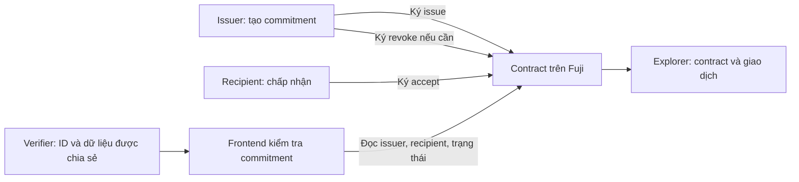

# UniHack Proposal — Ý tưởng và phương án sản phẩm

> Ghi chú **2026-11-05 00:38:27 +07:00**: phần bên dưới là lịch sử các ý tưởng từng cân nhắc. Hướng hiện hành đã chọn **HomeStayDorm × Avalanche** theo [plan.md](plan.md) và [spec/scope.md](../spec/scope.md). Các câu “chưa chọn” hay “ưu tiên hiện tại” trong thân tài liệu thuộc giai đoạn nghiên cứu cũ, không thay đổi lựa chọn đang thực hiện.

Nơi lưu các ý tưởng, so sánh, lựa chọn và thiết kế để tiếp tục phát triển. Các ý tưởng đều là giả thuyết ban đầu và **chưa có lựa chọn cuối cùng**. Thể lệ và hạn nộp xem [README.md](README.md); kiến thức nền và kế hoạch làm việc xem [Unihack_Context.md](Unihack_Context.md).

## Hướng nghiên cứu hiện tại: bài toán doanh nghiệp và cơ hội sản phẩm

Vy muốn tìm một vấn đề của công ty hoặc ứng dụng, có thể tiếp tục phát triển sau cuộc thi. Tạm thời không ưu tiên chủ đề thực tập hay chọn đề tài để thể hiện kỹ năng BA. Mentor cho phép bắt đầu với ứng dụng web truyền thống và chọn phần phù hợp để đưa lên Avalanche.

**Cách đọc:** `[Nguồn]` là điều nguồn liên kết xác nhận. `[GĐ]` là giả thuyết cần hỏi khách hàng. Mỗi ý tưởng là một **hướng nghiên cứu**, chưa chứng minh sản phẩm có thị trường, khác biệt đủ lớn hoặc có thể thu hút đầu tư. Chưa có phỏng vấn hay số liệu của một doanh nghiệp cụ thể. Mọi demo dùng dữ liệu giả, Fuji, không dùng tiền thật.

### 1. ReturnLoop — Phối hợp xử lý hàng đổi trả giữa nhiều bên

**Khách hàng dự kiến [GĐ]:** nhãn hàng bán qua nhiều kênh, có kho hoặc đơn vị sửa chữa bên ngoài; người xử lý hàng hoàn là người dùng chính. Họ có thể phải đối chiếu tình trạng hàng giữa bộ phận bán hàng, kho, vận chuyển và bảo hành để quyết định hoàn tiền, đổi hoặc sửa.

**Bằng chứng có bài toán:** [Shopify có quy trình khách yêu cầu trả hàng và cửa hàng duyệt/từ chối](https://help.shopify.com/en/manual/fulfillment/managing-orders/returns/self-serve-returns/index); [Stripe mô tả những bằng chứng doanh nghiệp có thể tập hợp khi có tranh chấp](https://docs.stripe.com/disputes/visual-evidence?locale=en-GB). Hai nguồn không chứng minh nhãn hàng Việt Nam gặp cùng mức khó khăn, và không chứng minh công nghệ mới giúp giảm gian lận.

**Tình huống:** khách báo tai nghe bị lỗi → cửa hàng duyệt nhận lại → kho xác nhận nhận được hàng và ghi tình trạng → đơn vị sửa chữa nhận kiểm tra → cửa hàng đưa ra phương án. Mỗi bên được xem thông tin mình cần; người xử lý biết bước nào đang chờ, và có một lịch sử tài liệu theo từng yêu cầu.

**Phần web:** tạo hồ sơ hàng hoàn giả, mã đơn giả, trạng thái, ảnh mẫu, lý do và bảng xử lý; thông tin thật nếu phát triển sau cần hệ thống bảo vệ/quyền truy cập. **Avalanche:** hai vai trò giả lập xác nhận một mốc bàn giao và hash của bằng chứng đã thống nhất; giao diện xem được trạng thái và transaction Fuji. Nội dung ảnh, tên, địa chỉ, mã đơn thật không đưa lên chain. Dùng salt ngẫu nhiên và quyền chia sẻ cho dữ liệu demo; hash vẫn có rủi ro lộ thông tin/liên kết.

**MVP một người:** một hồ sơ, 2 vai trò shop/kho; tạo yêu cầu → kho xác nhận nhận hàng → shop kiểm tra dấu vết trên Fuji. Không tích hợp sàn, hãng vận chuyển, AI hay hoàn tiền. Giao dịch minh họa bằng hai ví thử.

**Phát triển kinh doanh [GĐ]:** bán phần mềm cho thương hiệu xử lý hàng qua nhiều bên, thu phí theo gói; cần hỏi doanh nghiệp ai trả tiền, số lượng ca, thời gian xử lý và khả năng tích hợp. Khác biệt dự kiến là phối hợp chứng cứ giữa shop–kho–bảo hành, **chưa chứng minh** tốt hơn Shopify, phần mềm đổi trả hoặc database dùng chung. Blockchain không kiểm chứng được ảnh hay tình trạng hàng là thật, không tự giải quyết tranh chấp.

### 2. BatchBeacon — Tìm nhanh lô hàng và nơi cần thu hồi

**Khách hàng dự kiến [GĐ]:** nhà phân phối thực phẩm đóng gói hoặc sản phẩm có hạn sử dụng, phải chia lô cho nhiều cửa hàng/đại lý. Họ cần biết lô nào đã đi đâu khi có cảnh báo lỗi, hết hạn hoặc cần thu hồi.

**Bằng chứng có bài toán:** [GS1 EPCIS](https://support.gs1.org/support/solutions/articles/43000755325-what-is-electronic-product-code-information-services-epcis-) là chuẩn chia sẻ sự kiện truy xuất qua nhiều tổ chức. [FDA](https://www.fda.gov/food/food-safety-modernization-act-fsma/fsma-final-rule-requirements-additional-traceability-records-certain-foods) mô tả nhu cầu chia sẻ dữ liệu truy xuất cho một số thực phẩm ở Mỹ; đây là bối cảnh quốc tế, **không phải quy định chung cho mọi công ty Việt Nam**. [FDA FAQ](https://www.fda.gov/food/food-safety-modernization-act-fsma/frequently-asked-questions-fsma-food-traceability-rule) nói không bắt buộc một công nghệ cụ thể.

**Tình huống:** nhà phân phối nhập lô bánh `LOT-DEMO-01`, gửi 10 hộp cho cửa hàng A và 15 hộp cho B. Sau đó phát hiện lô có vấn đề, nhân viên tìm mã lô và thấy hai cửa hàng đã nhận, trạng thái liên hệ/thu hồi và số lượng cần xác nhận.

**Phần web:** quản lý lô giả, hạn, nơi gửi/nhận, số lượng và cảnh báo; nhập dữ liệu thủ công hoặc CSV giả lập. **Avalanche:** nhà phân phối và cửa hàng ký xác nhận sự kiện bàn giao hoặc thu hồi của một bản ghi giả; contract lưu commitment và trạng thái. Dữ liệu chi tiết và thông tin kinh doanh nằm ngoài chain, không đăng dữ liệu nhạy cảm.

**MVP một người:** một lô, một nhà phân phối, hai cửa hàng giả; ghi gửi → bên nhận xác nhận → tạo cảnh báo thu hồi → tìm nơi liên quan. Dùng dữ liệu demo, không tuyên bố tuân thủ GS1/FDA hay truy xuất toàn bộ chuỗi.

**Phát triển kinh doanh [GĐ]:** giải pháp theo dõi thu hồi cho nhà phân phối nhỏ hoặc đơn vị chưa kết nối hệ thống đối tác; có thể thu phí phần mềm. Cần nghiên cứu sản phẩm quản lý kho/traceability đang dùng, chi phí nhập liệu, ai chịu trách nhiệm cập nhật và giá trị tăng thêm trước khi nói đến đầu tư. **Giới hạn:** QR có thể bị sao chép, dữ liệu có thể nhập sai; blockchain không xác minh thực phẩm an toàn hoặc xác nhận hàng đã đến thật.

### 3. SupplyProof — Hồ sơ và hạn sử dụng chứng từ nhà cung cấp

**Khách hàng dự kiến [GĐ]:** doanh nghiệp mua hàng từ nhiều nhà cung cấp; nhân viên mua hàng/chất lượng cần kiểm tra giấy tờ, hiệu lực và bản cập nhật trước khi tiếp tục đặt hàng.

**Bằng chứng có bài toán:** [Atlassian công bố bảng câu hỏi an ninh cho đối tác](https://developer.atlassian.com/platform/marketplace/partner-security-questionnaire/) và cung cấp [Trust Portal](https://www.atlassian.com/trust/compliance/compliance-faq) tập trung tài liệu cho khách hàng. Điều đó xác nhận hoạt động thu thập/chia sẻ thông tin nhà cung cấp tồn tại ở ví dụ này; chưa chứng minh đối tượng nào sẵn sàng trả tiền cho giải pháp đề xuất.

**Tình huống:** nhà cung cấp tải chứng từ giả lên; doanh nghiệp đặt ngày hết hạn, xem ai phụ trách kiểm tra, yêu cầu bổ sung bản mới; khi có phiên bản mới, nhân viên biết bản cũ không còn là bản đang dùng.

**Phần web:** danh sách nhà cung cấp giả, tài liệu, phiên bản, thời hạn, nhắc việc và quyền xem. **Avalanche:** một ví demo của bên phát hành/đơn vị xác thực ghi commitment của tài liệu đã cấp và trạng thái thu hồi; doanh nghiệp chỉ đối chiếu bằng chứng được chia sẻ. Không đưa chứng từ, tên cá nhân hoặc thông tin nhạy cảm lên chain.

**MVP:** nhà cung cấp nộp tài liệu giả → bên xác thực ký một phiên bản → bên mua kiểm tra trạng thái → bản được thu hồi hiển thị hết hiệu lực theo trạng thái của contract. Không khẳng định đã kết nối cơ quan cấp hoặc chứng từ là thật. Mức tin cậy phụ thuộc vào **ai được công nhận là bên phát hành** và quy trình xác minh danh tính ngoài chain.

**Phát triển kinh doanh [GĐ]:** phần mềm theo dõi tài liệu giữa người mua và nhà cung cấp; phí theo tổ chức hoặc số lượng nhà cung cấp. Cần kiểm chứng nhu cầu, yêu cầu bảo mật và sản phẩm khách đang dùng. Một Trust Portal hay hệ thống quản lý tài liệu đã có thể giải quyết phần lớn vấn đề; mình phải tìm một nhóm khách cụ thể có nhu cầu chưa được đáp ứng.

### 4. VendorSafe — Xác minh thay đổi thông tin nhận thanh toán của đối tác

**Khách hàng dự kiến [GĐ]:** bộ phận kế toán/mua hàng của doanh nghiệp thường xuyên trả tiền cho nhà cung cấp. **Bài toán có thật ở mức quốc tế:** [FBI IC3](https://www.ic3.gov/PSA/2020/PSA200406) mô tả việc kẻ gian chiếm/giả mạo email doanh nghiệp rồi yêu cầu chuyển tiền sang tài khoản khác. Đây không phải số liệu tình hình Việt Nam hay bằng chứng sản phẩm đề xuất ngăn được lừa đảo.

**Tình huống:** nhân viên nhận email nói nhà cung cấp đổi số tài khoản. Thay vì dựa vào một email, nhân viên mở hồ sơ đối tác, tạo yêu cầu kiểm tra và đối chiếu với thông tin đã được xác nhận qua một kênh độc lập. Bản demo dùng tên và số tài khoản giả.

**Phần web:** quy trình yêu cầu thay đổi, người duyệt và trạng thái xác minh. **Avalanche có thể thử:** ví đối tác đã được xác minh từ trước xác nhận một commitment của thông tin mới và trạng thái; người mua tra cứu. Không lưu số tài khoản, thông tin cá nhân, hóa đơn hay nội dung email trên chain.

**MVP:** hai tổ chức giả lập, một yêu cầu thay đổi, trạng thái chờ/xác nhận và giao dịch Fuji. Không kết nối ngân hàng, không thực hiện thanh toán, không chấm điểm rủi ro tự động. **Giới hạn quan trọng:** nếu xác minh ban đầu sai, ví bị chiếm hoặc nhân viên bỏ qua quy trình xác nhận độc lập, hệ thống vẫn có thể bị lừa. Đây là một giả thuyết về hỗ trợ quy trình, không phải sản phẩm bảo đảm an toàn tài chính.

**Phát triển kinh doanh [GĐ]:** công cụ kiểm soát thay đổi đối tác cho doanh nghiệp có nhiều nhà cung cấp; cần kiểm tra giải pháp sẵn có, yêu cầu bảo mật, quy trình xác minh và khách sẵn sàng trả tiền. Độ khó đưa vào sử dụng thực tế cao hơn ba ý tưởng trên vì liên quan an ninh và tiền.

### 5. ServicePassport — Lịch sử sửa chữa cho thiết bị đã qua sử dụng

**Khách hàng dự kiến [GĐ]:** chuỗi bán thiết bị cũ, đơn vị sửa chữa hoặc doanh nghiệp quản lý thiết bị; người mua cần biết thiết bị được ghi nhận sửa chữa những gì trước khi quyết định.

**Tình huống:** một laptop demo được cửa hàng ghi nhận thay pin; đơn vị sửa xác nhận công việc; cửa hàng bán lại cho khách. Web cho xem lịch sử sửa và tình trạng bảo hành được chia sẻ. Tính năng phân quyền và nội dung chi tiết hoạt động như một web quản lý thông thường.

**Avalanche:** cửa hàng và đơn vị sửa dùng ví thử ký một sự kiện bảo trì gắn commitment của phiếu sửa giả. Người mua xem trạng thái ghi nhận. Không công khai số serial thật, dữ liệu cá nhân hay hóa đơn. **MVP:** tạo thiết bị giả → ghi một lần sửa → bên sửa xác nhận → người mua tra cứu.

**Phát triển kinh doanh [GĐ]:** bán cho chuỗi sửa/bán thiết bị cũ hoặc đơn vị quản lý tài sản; sau này cân nhắc lịch nhắc bảo trì và tích hợp hệ thống. Cần hỏi họ hiện ghi lịch sử ở đâu và có nhu cầu chia sẻ liên đơn vị không. **Giới hạn:** QR/ID có thể bị sao chép; ví ký không chứng minh việc sửa thật sự diễn ra; cần cơ chế xác minh đối tác ngoài chain. Có thể dùng database và chữ ký số cho bài toán này.

### So sánh ban đầu và cách quyết định

| Ý tưởng | Ai có thể trả tiền [GĐ] | Vấn đề demo | Khả năng tiếp cận người để hỏi [GĐ] | Rủi ro chính |
|---|---|---|---|---|
| **ReturnLoop** | Nhãn hàng/shop có kho hoặc bảo hành bên ngoài | Phối hợp các bước nhận hàng hoàn | Chủ shop, người bán, nhân viên kho | Có nhiều phần mềm đổi trả; dữ liệu ảnh không chứng minh sự thật |
| **BatchBeacon** | Nhà phân phối có nhiều cửa hàng | Tìm lô và nơi cần thu hồi | Chủ shop thực phẩm, người quản lý kho | Khó tiếp cận dữ liệu chuỗi; truy xuất phụ thuộc người nhập |
| **SupplyProof** | Doanh nghiệp mua hàng từ nhiều nhà cung cấp | Theo dõi chứng từ và bản bị thu hồi | Người làm mua hàng/chất lượng | Cần tin tổ chức cấp; nhiều công cụ quản lý hồ sơ |
| **VendorSafe** | Doanh nghiệp thường thanh toán nhà cung cấp | Xác nhận thay đổi thông tin đối tác | Kế toán/mua hàng nếu có liên hệ | Độ tin cậy và bảo mật cao; không chứng minh chống lừa đảo |
| **ServicePassport** | Chuỗi sửa/bán thiết bị cũ | Chia sẻ lịch sử sửa | Cửa hàng laptop/điện thoại | Dữ liệu đầu vào, mã giả và xác minh đối tác |

**Ưu tiên nghiên cứu:** ReturnLoop nếu có thể hỏi shop/kho, hoặc BatchBeacon nếu tìm được người quản lý hàng theo lô. ReturnLoop có phạm vi demo hẹp, còn BatchBeacon có câu chuyện truy xuất giữa doanh nghiệp và cửa hàng; cả hai cần chứng minh **khách gặp vấn đề đáng trả tiền** và blockchain có giá trị so với web thông thường. ServicePassport cũng dễ tưởng tượng nếu Vy có cửa hàng thiết bị để trao đổi. Đây chưa phải xếp hạng đầu tư hay lựa chọn cuối cùng.

**Kiểm chứng trong tuần đầu, trước khi build:**

1. Chọn 2 hướng mà Vy thấy hứng thú, tìm ít nhất 2–3 người đang làm công việc liên quan cho mỗi hướng nếu tiếp cận được.
2. Hỏi lần gần nhất họ gặp tình huống: xử lý ra sao, dùng phần mềm gì, bước nào mất công, bao lâu có một ca, ai chịu trách nhiệm và hậu quả khi sai. Không hỏi dẫn dắt “có cần blockchain không?”.
3. Xem đối thủ hiện có bằng link nguồn và hỏi tính năng còn thiếu tại công ty họ. Ghi cả câu trả lời “không gặp vấn đề” hoặc “công cụ hiện tại đã đủ”.
4. Kiểm tra ai có quyền mua, nhu cầu bảo mật và liệu họ có muốn các đối tác cùng tham gia. Đề xuất giá/hiệu quả chỉ là giả thuyết cho đến khi khảo sát.
5. Phác một luồng có 2 vai trò; gửi mentor hỏi: “Nếu web xử lý nghiệp vụ bình thường, phần xác nhận/bằng chứng nào thực sự nên đưa lên Avalanche để có ích và thể hiện tốt kỹ thuật?”

**Nguồn tham khảo chính:** [Shopify — self-service returns](https://help.shopify.com/en/manual/fulfillment/managing-orders/returns/self-serve-returns/index); [Stripe — bằng chứng tranh chấp](https://docs.stripe.com/disputes/visual-evidence?locale=en-GB); [GS1 — EPCIS](https://support.gs1.org/support/solutions/articles/43000755325-what-is-electronic-product-code-information-services-epcis-); [FDA — truy xuất thực phẩm tại Mỹ](https://www.fda.gov/food/food-safety-modernization-act-fsma/fsma-final-rule-requirements-additional-traceability-records-certain-foods); [Zoho — ghi nhận hàng nhận](https://www.zoho.com/us/inventory/help/purchase-orders/purchase-receive.html); [Atlassian — security questionnaire](https://developer.atlassian.com/platform/marketplace/partner-security-questionnaire/); [FBI IC3 — lừa đảo email doanh nghiệp](https://www.ic3.gov/PSA/2020/PSA200406). Những nguồn này cho thấy bối cảnh và ví dụ giải pháp đã tồn tại, không xác nhận tính mới hay hiệu quả của đề xuất.

---

## Các đề xuất trước: hướng BA intern

Các ý tưởng bên dưới được giữ làm tài liệu tham khảo, **không còn là hướng ưu tiên hiện tại** theo mong muốn mới của Vy.

### Bối cảnh và các ý tưởng BA intern trước đây

> Bối cảnh: Vy làm solo, đang học blockchain và quan tâm công việc BA hoặc backend. Mentor nói có thể xuất phát từ đề tài truyền thống, phần nào phù hợp mới đưa lên Avalanche. Những khó khăn dưới đây là **giả thuyết cần hỏi người dùng**, chưa có dữ liệu chứng minh mức độ phổ biến hay hiệu quả sản phẩm.

### 1. InternBridge — Theo dõi và xác nhận quá trình thực tập

**Bài toán [giả thuyết]:** sinh viên, người hướng dẫn doanh nghiệp và giảng viên cần theo dõi mục tiêu, sản phẩm bàn giao và phản hồi trong kỳ thực tập. Thông tin có thể nằm rải rác giữa email, file và tin nhắn, khiến mỗi bên khó biết bản nào đã được xác nhận.

**Người dùng:** sinh viên thực tập; mentor ở công ty; giảng viên hoặc người theo dõi của trường. Có thể bắt đầu hỏi sinh viên đã đi thực tập và một người hướng dẫn để tìm tình huống thực tế.

**Ví dụ:** Vy làm thực tập BA. Đầu tuần tạo mục tiêu “vẽ luồng xử lý yêu cầu khách hàng”. Cuối tuần gửi link sản phẩm và báo đã hoàn thành. Mentor xem, yêu cầu sửa hoặc xác nhận một phiên bản. Vy và giảng viên xem được tiến độ, phản hồi và phiên bản đã xác nhận.

**Các chức năng web thông thường:** tạo kỳ thực tập và mục tiêu; ghi nhật ký/milestone; nộp link/file giả; phản hồi, yêu cầu sửa, theo dõi trạng thái và quyền xem. MVP có thể dùng tài khoản demo, một milestone và hai vai trò sinh viên/mentor; phần giảng viên chỉ cần màn hình xem hoặc để sau.

**Phần Avalanche đề xuất:** khi mentor xác nhận một phiên bản, contract Fuji ghi **mã cam kết nội dung (hash kèm salt), ví mentor và trạng thái xác nhận**; mentor có thể thu hồi khi xác nhận nhầm. Người được chia sẻ bản dữ liệu và salt có thể kiểm tra bản đó có khớp dấu vân tay đã ghi hay không. Dùng dữ liệu giả; không đưa tên, báo cáo, nhận xét hay thông tin cá nhân lên chain. Hash và ví vẫn có rủi ro liên kết; hash không tự biến dữ liệu thành bí mật.

**Giá trị blockchain cần kiểm chứng:** một bên thứ ba có thể kiểm tra cùng trạng thái và dấu vết xác nhận qua contract; tuy nhiên database có phân quyền, nhật ký và chữ ký số cũng có thể đáp ứng. Chain không chứng minh người ký thật sự là mentor, không chứng minh sinh viên hoàn thành tốt, và không thay thế việc trường hoặc công ty xác nhận danh tính. Cần hỏi người dùng có thực sự cần xác minh độc lập hay không; nếu không, cân nhắc ý tưởng khác.

**MVP solo:** tạo milestone giả → sinh viên nộp phiên bản → mentor xác nhận bằng ví trên Fuji → trang kiểm tra đọc trạng thái + link giao dịch → mentor thu hồi nếu xác nhận sai. Không cần tích hợp hệ thống trường/doanh nghiệp thật, ví thật có tiền, AI hay NFT. Bản demo chỉ thể hiện hai ví được gán vai trò giả lập.

**M có thể thể hiện gì khi xin BA?** Vẽ quy trình thực tập hiện tại và quy trình đề xuất; phân biệt nhu cầu ba bên; viết user story và điều kiện nghiệm thu; xác định khi nào gửi lại, ai được sửa, ai được xem, xử lý xác nhận sai. Nếu làm backend, thêm API, phân quyền và database cho phần ngoài chain.

**Có thể phát triển sau cuộc thi:** nếu kiểm chứng được nhu cầu, mở rộng cho nhiều trường/doanh nghiệp, nhắc deadline, báo cáo tiến độ, xuất minh chứng hoặc tích hợp hệ thống thực tập. Các mục này cần sự đồng ý và dữ liệu thật từ bên liên quan; không nằm trong cam kết MVP.

**Rủi ro:** nhà trường/doanh nghiệp có thể đã có công cụ; mentor có thể ngại dùng ví; dữ liệu nhạy cảm cần kiểm soát; người tham gia có thể không cần on-chain. Đây là lý do cần trao đổi với người dùng và mentor trước khi chốt.

### 2. ScopeBridge — Quản lý yêu cầu thay đổi giữa khách hàng và nhóm làm phần mềm

**Bài toán [giả thuyết]:** trong một dự án freelance hoặc đồ án có khách hàng, yêu cầu thay đổi được trao đổi qua nhiều kênh; các bên có thể khó thống nhất phiên bản nào đã được đồng ý, ảnh hưởng phạm vi và thời hạn ra sao.

**Ví dụ:** khách hàng đề nghị thêm chức năng hủy đơn. BA ghi yêu cầu, tác động lên màn hình/API và đề xuất thời gian; khách xem rồi chấp nhận hoặc yêu cầu sửa. Mỗi bản có lịch sử và trạng thái rõ ràng.

**Web thường:** yêu cầu thay đổi, mô tả, phiên bản, mức ưu tiên, tác động và bình luận; tài khoản, quyền xem và nội dung chi tiết nằm ngoài chain. **Avalanche:** hai bên xác nhận hash của một phiên bản giả và có thể kiểm tra trạng thái chấp nhận. Giao dịch dùng ví thử, không đưa nội dung hợp đồng thương mại lên chain.

**MVP:** tạo một yêu cầu → gửi khách xem → khách đồng ý một phiên bản → sửa nội dung thành bản mới và trạng thái quay lại chờ xác nhận → tra trạng thái trên explorer. Contract chỉ ghi nhận hành vi của ví; không tự chứng minh tư cách pháp lý hay thay chữ ký hợp đồng hợp lệ.

**Giá trị BA:** stakeholder, thu thập và làm rõ yêu cầu, quản lý thay đổi, impact analysis, duyệt yêu cầu và tiêu chí nghiệm thu. **Tương lai:** quản lý các thay đổi cho một agency/đồ án; tích hợp Jira/GitHub khi có nhu cầu. **Rủi ro:** Jira, email và chữ ký số đã hỗ trợ một phần quy trình; phải chứng minh vì sao hai bên cần trạng thái chung trên chain. GitHub Projects cũng đã có [các workflow tự động cho trạng thái](https://docs.github.com/en/issues/planning-and-tracking-with-projects/automating-your-project/using-the-built-in-automations).

### 3. RepairPass — Theo dõi bảo hành và sửa chữa thiết bị

**Bài toán [giả thuyết]:** người mua và cửa hàng khó theo dõi yêu cầu sửa, kết quả xử lý và giấy bàn giao khi thông tin nằm ở nhiều nơi. Có thể bắt đầu bằng cửa hàng sửa laptop/điện thoại nhỏ hoặc thiết bị của CLB.

**Ví dụ:** khách gửi laptop; cửa hàng tạo phiếu giả, cập nhật “đã nhận → đang kiểm tra → đã xử lý → bàn giao”; khách kiểm tra và xác nhận đã nhận. Đơn sửa và mô tả hiện tượng nằm trong app thông thường.

**Avalanche:** cửa hàng ghi xác nhận bàn giao gắn với mã phiếu giả, người nhận chấp nhận, trạng thái được đọc công khai qua contract. Không lưu tên, số điện thoại, số serial thật hoặc địa chỉ trên chain. **MVP:** một phiếu, hai vai trò, chuyển trạng thái và xác nhận bàn giao. Không cần thanh toán, camera hoặc kết nối cửa hàng thật.

**Giá trị BA:** phỏng vấn cửa hàng, tìm điểm nghẽn, vẽ luồng sửa chữa, quy định trạng thái và trường hợp khách từ chối nhận. **Tương lai:** nhắc bảo hành, linh kiện, nhiều chi nhánh. **Rủi ro:** trạng thái on-chain không chứng minh chất lượng sửa chữa; database/QR đã có thể đáp ứng nếu khách chỉ làm việc với một cửa hàng, nên cần đánh giá lý do dùng chain.

### 4. ClubGrant — Theo dõi cam kết tài trợ hiện vật cho hoạt động sinh viên

**Bài toán [giả thuyết]:** ban tổ chức và nhà tài trợ cần thống nhất đã cam kết hỗ trợ gì, khi nào giao và trạng thái tiếp nhận; thông tin nằm rải rác có thể làm khó việc đối chiếu.

**Ví dụ:** nhà tài trợ giả lập cam kết cung cấp 20 chai nước; CLB xác nhận đã nhận. Web lưu mô tả và checklist; contract ghi hash của cam kết và hai trạng thái xác nhận của các ví giả lập.

**MVP:** tạo cam kết hiện vật giả → bên tài trợ xác nhận → CLB xác nhận đã nhận → người được cho phép xem lịch sử và đối chiếu. Không nhận tiền, không gây quỹ, không tạo token hoặc phần thưởng ngẫu nhiên.

**Giá trị BA:** phân tích hai bên, quy tắc nghiệm thu, tình huống giao thiếu/giao sai. **Tương lai:** báo cáo hoạt động, nhiều sự kiện, theo dõi cam kết và bằng chứng được cấp quyền. **Rủi ro:** chain không chứng minh hàng đã giao; công khai giao dịch có thể lộ quan hệ giữa các bên; phải xác minh nhu cầu qua người tổ chức và đối chiếu với giải pháp web thông thường.

### So sánh và gợi ý đi tiếp

| Phương án | Ai dễ hỏi để hiểu vấn đề? | Kỹ năng BA dễ thể hiện | Điểm cần kiểm tra trước khi chọn |
|---|---|---|---|
| **InternBridge** | Sinh viên thực tập, mentor, giảng viên nếu có liên hệ | Luồng nhiều bên, mục tiêu, phản hồi, xác nhận | Có thật sự khó đối chiếu? Trường/công ty đã có hệ thống gì? Có cần bên thứ ba xác minh? |
| **ScopeBridge** | Bạn làm freelance/đồ án, người từng làm BA/dev/khách hàng | Quản lý yêu cầu và thay đổi, phân tích tác động | Người dùng có chấp nhận xác nhận bằng ví? Blockchain có thêm giá trị so với Jira/chữ ký số? |
| **RepairPass** | Chủ tiệm hoặc người từng đi sửa thiết bị | Quy trình vận hành, trạng thái, ngoại lệ | Có được tiếp cận cửa hàng? Lợi ích chain có đủ rõ? |
| **ClubGrant** | Ban tổ chức CLB và người từng làm tài trợ | Hai bên cam kết, giao nhận, xử lý thiếu | Có thể hỏi được cả hai bên? Có nhạy cảm về thông tin đối tác? |

**Đề xuất tạm thời: tìm hiểu InternBridge trước**, vì Vy gần nhóm người dùng sinh viên và có thể kể một luồng nghiệp vụ nhiều bên khi xin BA intern. **ScopeBridge** là phương án nên tìm hiểu song song nếu Vy thích nghiệp vụ BA phần mềm hơn. Đây là ưu tiên nghiên cứu, chưa phải ý tưởng đã chốt; nếu không tìm được người để hỏi hoặc phần chain không có giá trị rõ, đổi phương án.

**Phỏng vấn ngắn 3–5 người nếu tiếp cận được:** 2 sinh viên đã/đang thực tập, 1 mentor hoặc giảng viên, và 1 người làm dự án freelance/BA để so sánh. Hỏi về lần gần nhất họ gặp việc đó, dùng công cụ gì, ai xác nhận, chuyện gì xảy ra khi sai, phần bất tiện và cách giải quyết. Ghi riêng điều người dùng nói, giả định và điều chưa biết; không mặc định rằng người được hỏi cần blockchain.

**Câu hỏi gửi mentor sau khi học nền tảng:** “Em đang tìm hiểu một hệ thống theo dõi quá trình thực tập giữa sinh viên và mentor: nội dung/feedback lưu ở web, em dự định ghi xác nhận và trạng thái thu hồi trên Fuji để bên được chia sẻ kiểm tra. Với nhu cầu này, Avalanche đã phù hợp chưa, em cần demo giao dịch nào và cần tránh đưa dữ liệu gì lên chain ạ?” Có thể gửi kèm phương án ScopeBridge để nhờ so sánh.

**Cơ sở tham khảo:** [Atlassian — thu thập yêu cầu](https://www.atlassian.com/it/work-management/project-management/requirements-gathering) mô tả stakeholder, phạm vi và tiêu chí nghiệm thu; [1EdTech Open Badges](https://standards.1edtech.org/open-badges/specifications/standards/v3p0) là ví dụ tiêu chuẩn chứng nhận có thể kiểm chứng, trong đó kiểm tra tính xác thực không chứng minh nội dung khẳng định là đúng. Hai nguồn cho thấy hướng nghiệp vụ và giải pháp liên quan đã tồn tại, **không chứng minh sản phẩm đề xuất có nhu cầu hay cần blockchain**.

---

## Các ý tưởng và đánh giá trước đây

Bảng cũ bên dưới được giữ để đối chiếu; ưu tiên Proof of Contribution trước đây chưa tính đến hướng BA intern vừa được Vy bổ sung. Cần đánh giá lại trên cùng cơ sở sau khi tìm hiểu bốn hướng ở trên.

## 1. Sáu hướng khởi đầu — tự do đổi hoặc nghĩ thêm

Mọi vấn đề dưới đây là **giả thuyết**, không phải kết quả khảo sát. Những phần dùng trạng thái/điểm đều dùng dữ liệu giả, không nhận tiền thật.

| Ý tưởng | Người dùng và vấn đề [GĐ] | Phần on-chain, demo tối thiểu | Rủi ro / độ khó solo |
|---|---|---|---|
| **A. Proof of Contribution** | CLB/sinh viên/bên xác minh khó đối chiếu ai xác nhận và trạng thái bằng chứng hoạt động | Issuer cấp hash; người nhận chấp nhận; issuer thu hồi; bên thứ ba tra trạng thái | Phải xác định issuer đáng tin; bảo vệ dữ liệu; không chứng minh hoạt động đã diễn ra |
| B. Milestone handshake | Hai sinh viên/nhóm cộng tác không rõ phiên bản nào được bàn giao và xác nhận | Người làm nộp hash phiên bản; bên nhận xác nhận/từ chối; lịch sử công khai | Hợp đồng không giải quyết chất lượng, cần consent và quản lý phiên bản |
| C. DemoDay feedback receipt | Người tổ chức demo day cần ghi nhận feedback đã được người trình bày tiếp nhận mà không công khai nội dung | Reviewer gửi hash feedback, người trình bày đánh dấu đã nhận, thu hồi/phiên bản | Giá trị on-chain có thể yếu nếu chỉ hai người; hash cần salt |
| D. Open-source contribution bounty board không tiền | Dự án CLB giao nhiệm vụ, xác nhận ai hoàn thành và ghi nhận công bằng | Chủ nhiệm tạo task; người nhận claim; chủ nhiệm xác nhận; public state | Chủ nhiệm vẫn có quyền đánh giá; không tạo thưởng ngẫu nhiên/token |
| E. Thẻ bảo hành đồ dùng chung | CLB cho mượn thiết bị, bên mượn khó kiểm tra trạng thái và ai xác nhận bàn giao | Thiết bị có ID giả; hai ví xác nhận giao/nhận/trả; trạng thái on-chain | Không chứng minh tài sản thực; không lưu tên/sđt; mô hình nhiều thiết bị tốn công |
| F. Game giải đố theo lượt | Người chơi muốn cùng kiểm tra lời giải/luật điểm minh bạch | 2–3 câu đố cố định, lưu điểm theo luật xác định, tx nộp kết quả | Lộ đáp án nếu để trực tiếp trong contract; commit-reveal phức tạp, tránh ngẫu nhiên/giải thưởng |

## 2. Ma trận chọn ban đầu

Chấm chủ quan 1–5, 5 là tốt; điểm có trọng số = `điểm / 5 × trọng số`. Trọng số là **công cụ ra quyết định cá nhân**, không phải thang BTC: khả thi solo 25, ý nghĩa on-chain 25, vấn đề/tác động 20, demo 15, khác biệt 15. Điểm chưa có khảo sát; đổi khi có bằng chứng.

| Ý tưởng | Khả thi /5 | On-chain /5 | Vấn đề /5 | Demo /5 | Khác biệt /5 | Tổng /100 |
|---|---:|---:|---:|---:|---:|---:|
| A. Proof of Contribution | 4 | 4 | 4 | 5 | 3 | **80** |
| B. Milestone handshake | 4 | 4 | 4 | 4 | 3 | **77** |
| C. Feedback receipt | 4 | 2 | 2 | 4 | 3 | **59** |
| D. Bounty board không tiền | 4 | 3 | 3 | 4 | 3 | **68** |
| E. Bàn giao thiết bị | 3 | 3 | 4 | 4 | 4 | **70** |
| F. Game giải đố | 2 | 3 | 2 | 4 | 3 | **54** |

Ví dụ A: `4/5×25 + 4/5×25 + 4/5×20 + 5/5×15 + 3/5×15 = 80`. Đánh giá nhạy: nếu khả thi của A giảm 4 → 3, A còn 75 và B = 77; nếu người dùng không thấy giá trị xác minh liên tổ chức, hạ điểm on-chain/tác động và chọn lại. Bảng này là điểm trước khi nghiên cứu người dùng, không phải dự đoán điểm giám khảo.

**Đề xuất tạm chọn A** vì có nhiều vai trò, trạng thái chung, luồng kiểm tra/thu hồi rõ và dễ trình diễn bằng hai ví. Phương án B dự phòng nếu phỏng vấn cho thấy xác minh đóng góp không có người dùng cụ thể. Việc chốt cuối phải dựa vào sở thích, kỹ năng, thời gian thực tế của Vy và phản hồi người dùng; không có dữ kiện nào ở đây chứng minh A chắc thắng.

## 3. Thiết kế MVP đề xuất: Proof of Contribution

### 3.1. Một câu pitch và phạm vi

“Một công cụ để CLB phát hành và thu hồi xác nhận đóng góp, để sinh viên và bên thứ ba đối chiếu trạng thái bằng chứng trên Avalanche Fuji.”

Ví dụ demo: CLB tổ chức sự kiện giả lập, cấp xác nhận “hỗ trợ tổ chức” cho ví sinh viên; sinh viên chấp nhận; người xem kiểm tra ID, issuer, recipient, commitment và trạng thái; sau đó issuer thu hồi do cấp nhầm, người xem thấy trạng thái đổi. Không khẳng định có CLB thật, người dùng thật hoặc tuyển dụng thực tế khi chưa có.

**Vai trò:** issuer = ví tổ chức demo; recipient = ví người nhận; verifier = bất kỳ ai đọc. Một issuer được chỉ định lúc deploy trong MVP; nếu sau này có nhiều tổ chức, cần cơ chế registry và xác minh danh tính riêng. Không lấy địa chỉ hiển thị làm bằng chứng danh tính ngoài đời.

### 3.2. Chức năng bắt buộc và ngoài phạm vi

| Luồng | Quy tắc MVP | Tiêu chí hoàn thành |
|---|---|---|
| Issue | Chỉ issuer đã cấu hình tạo record với ID, recipient `0x...`, commitment; ID duy nhất; recipient hợp lệ | Ví A cấp cho B, receipt thành công, record đọc lại đúng; ví khác bị revert |
| Accept | Chỉ recipient chấp nhận record còn hiệu lực và chưa accept | B ký chấp nhận; ví C và lần chấp nhận lặp bị từ chối; state hiển thị đúng |
| Revoke | Chỉ issuer thu hồi record tồn tại/chưa thu hồi, cả trước hoặc sau khi accept; record không thể phục hồi trong MVP | Ví A thu hồi, verify báo revoked; ví khác không thể thu hồi |
| Verify | Ai cũng tra ID và xem issuer, recipient, commitment, accepted, revoked; so hash đầu vào chia sẻ ngoài chain | Giao diện phân biệt không tồn tại, issued/chưa nhận, accepted, revoked và hash không khớp |
| Event + bằng chứng | `Issued`, `Accepted`, `Revoked` kèm ID và các trường cần thiết, không có PII | Test sự kiện và có link tx/explorer |

MVP **không** cần tiền, NFT, phần thưởng, backend, mạng L1 riêng hay email thật. Không tự tuyên bố chứng nhận này là bằng cấp chính thức hoặc danh tính đã KYC. Cấp lại sau thu hồi là ID mới; không cho sửa commitment cũ. Quy định phiên bản này là quyết định thiết kế đề xuất, không phải quy định BTC.

### 3.3. Dữ liệu, commitment và xác thực

- Trên chain: `id`, địa chỉ issuer/recipient, commitment `bytes32`, trạng thái và event, timestamp nếu cần. Không lưu tên người, tên CLB, email, số điện thoại hay nội dung PDF.
- Ngoài chain: dùng bản dữ liệu **giả** có các trường đóng góp, thời gian, vai trò; tự tạo salt ngẫu nhiên riêng. Người cấp chia sẻ bộ dữ liệu + salt cho người nhận/verifier qua kênh phù hợp. Không cần server/IPFS để demo.
- Định nghĩa và công bố cách **chuẩn hóa chính xác**: ví dụ chuỗi UTF-8 JSON với thứ tự field cố định, không tự thay khoảng trắng hoặc Unicode; mã hóa field theo cách nhất quán và băm bằng `keccak256` qua viem. Người verify phải dùng đúng cùng quy tắc và salt, không tự băm một JSON khác. Ghi phiên bản format trong repo. Dữ liệu thay đổi bất kỳ trường nào → commitment khác.
- Đối chiếu hash chỉ nói bản nhận được khớp bản từng được commit; không chứng minh sự kiện có thật, không chứng minh quyền sở hữu pháp lý, không chứng minh một ví thuộc cá nhân/tổ chức nào. Người nhận biết được nội dung nhờ trao đổi ngoài chain trước khi bấm accept; contract chỉ nhìn thấy hash.
- Địa chỉ và quan hệ ví vẫn công khai. Demo dùng ví thử riêng; đừng lưu secret trong repo hay trình duyệt dưới dạng công khai. Không coi salt là giải pháp toàn diện cho quyền riêng tư.

### 3.4. Kiến trúc gọn và thứ tự build

| Thành phần | Trách nhiệm | Kết quả kiểm tra được |
|---|---|---|
| Solidity contract | Kiểm soát issuer, recipient, trạng thái, event | Tests pass, deploy Fuji, contract address |
| React/Vite + viem/wagmi | Kết nối ví, đúng mạng, gửi tx, đọc và kiểm tra hash | User thấy chờ ví → chờ xác nhận → thành công/thất bại |
| Ví thử A/B | Ký cấp/nhận/thu hồi | Hai địa chỉ khác nhau, tx trên explorer |
| RPC + explorer Fuji | Đọc/gửi và xem lịch sử | Link tra đúng chain, tx receipt |

**Thứ tự:** vẽ trạng thái → viết contract + test → deploy testnet → viết UI đọc → nối UI ghi → demo hai ví → rà soát/bổ sung test → ghi video. Đừng đợi UI đẹp mới kiểm tra contract.

**Test hành vi quan trọng:** issuer cấp thành công; người lạ cấp thất bại; ID trùng bị chặn; `address(0)` bị chặn; recipient accept thành công; sai ví/accept lặp bị từ chối; issuer revoke trước/sau accept; người lạ/revoke lặp bị từ chối; record không tồn tại; các event và dữ liệu không đổi sau hành động sai; hash đúng/sai ở UI. Không cần tuyên bố đã audit. Khi sửa contract sau deploy phải deploy lại và cập nhật ABI/địa chỉ trên UI; trạng thái cũ không tự chuyển.

**Giao diện tối thiểu:** trang Verify công khai; trang Issue cho issuer; trang My Record/Accept cho recipient; trạng thái ví, mạng, lỗi và liên kết explorer. Nếu thiếu thời gian, cùng một trang với ba tab đơn giản là đủ.

**Demo 2–3 phút:** 0:00 nêu dự án dùng Fuji và dữ liệu giả; 0:15 nêu vấn đề + giới hạn nguồn tin; 0:35 ví issuer issue; 1:00 đổi ví recipient accept; 1:20 verifier kiểm tra commitment/transaction; 1:45 issuer revoke, verifier thấy revoked; 2:10 giải thích vì sao on-chain, vì sao Avalanche, giới hạn và bước tiếp. Dựng sẵn tab explorer, account test và tx dự phòng. Nếu mô phỏng thời gian/khác, công bố ngay đầu như rules yêu cầu.

## 4. Dàn slide 7 trang

1. Tên + một câu pitch + Fuji/test data.
2. Người dùng, tình huống và vấn đề; ghi `[GĐ]` hoặc nêu số người đã phỏng vấn thực tế.
3. Cách làm hiện tại, phương án database/chữ ký số và lý do thử blockchain.
4. Luồng ba vai trò + demo issue → accept → verify → revoke.
5. Kiến trúc, contract address/tx link, quy tắc và test; khẳng định phần đã chạy.
6. Tác động dự kiến, dữ liệu riêng tư và giới hạn issuer/khả năng kiểm chứng.
7. Phạm vi MVP, việc tiếp theo, QR/link repo/video và lời kết.

## 5. Các câu hỏi phải tập trả lời

| Câu hỏi | Hướng trả lời trung thực |
|---|---|
| Vì sao không dùng database? | Database/chữ ký số có thể đủ; blockchain cho nhiều bên cùng xem lịch sử và trạng thái qua contract chung. Nhu cầu này chưa được chứng minh cho mọi tổ chức, cần phỏng vấn thêm |
| Vì sao Avalanche? | Fuji được BTC chấp nhận, EVM dùng Solidity và có công cụ/explorer để kiểm chứng; app dùng contract thật trên C-Chain |
| Ai chứng minh issuer là CLB? | MVP chưa có xác minh danh tính; cần registry/kiểm tra ngoài chain; demo chỉ là ví giả lập |
| Blockchain chứng minh người nhận thật sự làm việc? | Không; chỉ ghi issuer đã xác nhận và các trạng thái liên quan. Người xem vẫn đánh giá độ tin cậy issuer |
| Hash có giấu hết thông tin? | Không; dữ liệu dễ đoán có thể bị đoán lại, địa chỉ có thể liên kết. Dùng dữ liệu giả, salt riêng và chia sẻ có kiểm soát |
| Vì sao người dùng phải ký/gas? | Mỗi lần ghi trạng thái cần transaction; Fuji dùng test AVAX. UX và chi phí cho người mới là giới hạn cần nghiên cứu tiếp |
| Tiền/yield đến từ đâu? | MVP không có tiền hay yield. Nếu xây thành dịch vụ, nguồn vận hành là giả thuyết và phải kiểm chứng, không bịa doanh thu |
| Nếu issuer sai hoặc mất khóa? | Contract hỗ trợ issuer thu hồi, không tự xác định sự thật; mất khóa và thay issuer cần cơ chế quản trị mới, chưa có trong MVP |
| Kết quả/tác động đo thế nào? | Đo thời gian kiểm tra và số bước với một tập người dùng tự nguyện; hiện là giả thuyết cho đến khi đo |
| Có dùng AI/starter không? | Trình bày đúng phần nào dùng, phần tự phát triển, license và cách đã kiểm tra; quy định AI chi tiết hỏi BTC |
